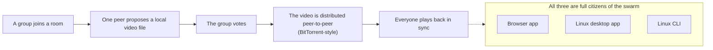

# PeerWatch Documentation

PeerWatch is a serverless, peer-to-peer watch party application. A group of
people join a **room**, one of them proposes a local video file, the group
votes, the video is distributed **peer-to-peer** (BitTorrent-style) while
everyone plays back in sync. Peers run as a **browser app**, a **Linux
desktop app**, or a **Linux CLI**. All three are full citizens of the swarm.

There is no media server. Video chunks, playback state, votes, and chat flow
directly between peers over encrypted WebRTC connections. The only
infrastructure is a tiny, optional, self-hostable **signaling relay** that
introduces peers to each other and never sees any room content.

These documents are the authoritative specification of PeerWatch v2 (the Rust
rewrite). They are written to be read by someone with **no prior knowledge**
of the system or of the underlying technologies. Every concept is explained
from first principles before it is used.

## Reading order

Read top-to-bottom if you want the full picture. Jump directly to a file if
you only care about one subsystem.

| # | Document | Scope |
|---|----------|-------|
| 1 | [architecture.md](architecture.md) | The whole system at a glance: terminology, the three frontends, the shared-core design, crate layout. |
| 2 | [connectivity.md](connectivity.md) | How peers find and connect to each other: WebRTC, ICE/STUN/TURN, DataChannels, the signaling relay, the full-mesh topology, the join sequence. |
| 3 | [identity.md](identity.md) | Who a peer is and how it proves it: Ed25519 identities, peer IDs, the challenge–response handshake, room authorization via invite tokens, key storage. |
| 4 | [media-pipeline.md](media-pipeline.md) | How an arbitrary local video becomes the canonical streamable format: fragmented MP4, segments, remuxing, live transcode-ahead, in-browser transmuxing. |
| 5 | [distribution.md](distribution.md) | How the video is chunked and shared: the manifest, pieces/blocks/segments, bitfields, the download scheduler, peer-selection mathematics, CANCEL accounting. |
| 6 | [storage.md](storage.md) | Where pieces live on each platform: native sparse files, browser in-memory + OPFS tiers, eviction policy, resume. |
| 7 | [sync.md](sync.md) | How everyone watches in lockstep: the host-as-clock-authority model, the PI drift controller, free-roam mode, host departure and source takeover. |
| 8 | [governance.md](governance.md) | Room democracy: proposals, votes, changing the host, kicking peers, tally rules. |
| 9 | [security.md](security.md) | Threat model, the layered defense design, automatic elimination of malicious peers, honest limitations. |
| 10 | [protocol.md](protocol.md) | The wire protocol: envelope format, channels, and the full message catalog with payload layouts. |
| 11 | [frontends.md](frontends.md) | Per-platform specifics: CLI (mpv), desktop (Tauri + MSE + fallback), browser (MSE), and how they interoperate. |
| 12 | [performance.md](performance.md) | The quantitative model: transfer-time formulas, scenario tables, CPU and memory budgets, cold-start latency. |
| 13 | [roadmap.md](roadmap.md) | Implementation phases (M1–M5) and the decision log recording *why* the design is the way it is. |

## Invariants every document must respect

If you change one of these, update every document that mentions it:

- **Data granularity levels** (Segment / Piece / Block, sizes and roles):
  see [architecture.md §1](architecture.md#1-terminology). Defined once there,
  referenced everywhere else.
- Canonical wire format: **fragmented MP4 (H.264/AAC)**, profile `FMP4`.
  Secondary profile `WEBM` (VP9/Opus) for browser-sourced WebM.
- **Host** = the peer whose file is currently playing (source + clock
  authority). Never the "room creator". Creators have no privileges.
- Invite token format: `pw_<room_id>.<secret>`.
- Identity: Ed25519. `peer_id = base32(blake3(pubkey))`, displayed `pw:…`.
