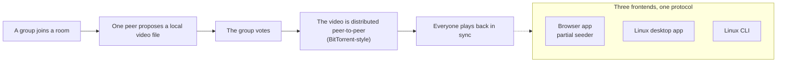

# PeerWatch Documentation

PeerWatch is a serverless, peer-to-peer watch party. A group joins a **room**,
one of them proposes a local video, the group votes, the video is distributed
**peer-to-peer** (BitTorrent-style) while everyone plays back in sync. Peers
run as a **browser app**, a **Linux desktop app**, or a **Linux CLI** — all
three are full protocol participants.



There is **no media server**. Video blocks, playback state, votes, and chat
flow directly between peers over encrypted WebRTC connections. The only
infrastructure is:

- a tiny, optional, self-hostable **signaling relay** (blind mailbox);
- **STUN** for NAT address discovery;
- optional **TURN** for the peer pairs that cannot punch through their NATs.

The relay introduces peers and never sees room content, room keys, or
plaintext SDP. TURN relays encrypted WebRTC packets and cannot read them
either.

---

## How this documentation is organised

Three tiers, and the tier tells you what kind of claim a document makes.

| Tier | Directory | Contains | If it disagrees with another tier |
|---|---|---|---|
| **Normative** | [`spec/`](spec/) | wire format, validation rules, limits, error codes, the core API | **wins** |
| **Design** | [`design/`](design/) | rationale, maths, subsystem behaviour, threat model, rejected alternatives | defers to `spec/` |
| **Guide** | [`guide/`](guide/) | configuration, operations, testing, conformance | defers to both |

### Precedence ladder

When two documents disagree, this order decides — highest first:

1. [`spec/protocol.md`](spec/protocol.md) — the wire
2. [`spec/core-api.md`](spec/core-api.md) — the in-process boundary
3. [`spec/errors.md`](spec/errors.md), [`spec/roaring-compression.md`](spec/roaring-compression.md)
4. everything in `design/` — except that a `design/` document restating a
   `spec/` fact is *wrong*, not authoritative
5. everything in `guide/`

A disagreement is a bug. Fix the loser and, if the fix changed a decision,
record it in [`design/design-log.md`](design/design-log.md).

### Reading order

If you are new, read top to bottom. If you only care about one subsystem, jump.

| # | Document | Tier | Scope |
|---|---|---|---|
| 1 | [architecture.md](design/architecture.md) | design | The whole system: terminology, the three frontends, shared core, crate layout, the five state machines, authority model. |
| 2 | [protocol.md](spec/protocol.md) | **normative** | Canonical CBOR, envelope, message catalog, authority certificates, manifest, Merkle proofs, limits, media parser limits, relay protocol. |
| 3 | [core-api.md](spec/core-api.md) | **normative** | The `Event`/`Command` contract between the core and every shell, timers, UI events, snapshot/conformance rules. |
| 4 | [errors.md](spec/errors.md) | **normative** | Every error code: `BYE`, relay, player, storage, media, network. |
| 5 | [connectivity.md](design/connectivity.md) | design | WebRTC, ICE/STUN/TURN, DataChannels, the signaling relay, the lobby channel, full mesh, join sequence. |
| 6 | [identity.md](design/identity.md) | design | Ed25519 + X25519, peer IDs, AUTH, invites, room keys, epochs, rekeying, what rotation does and does not achieve. |
| 7 | [media-pipeline.md](design/media-pipeline.md) | design | fMP4, segments, remux, live transcode-ahead, browser transmuxing, codec intersection. |
| 8 | [distribution.md](design/distribution.md) | design | Chunking, pieces/blocks/segments, Merkle proofs, bitfields, the scheduler, peer selection, CANCEL. |
| 9 | [storage.md](design/storage.md) | design | Native sparse files, browser memory + OPFS tiers, eviction, crash consistency, the store adapter. |
| 10 | [sync.md](design/sync.md) | design | Host lease/term, RTT compensation, the PI controller, free-roam, host departure, partitions. |
| 11 | [governance.md](design/governance.md) | design | Proposals, votes, certificates, host leases, kicks, banlist propagation, partition rules. |
| 12 | [security.md](design/security.md) | design | Threat model, defence layers, authorization vs signatures, blame, replay, Sybil, relay metadata, limitations. |
| 13 | [frontends.md](design/frontends.md) | design | Per-platform specifics: CLI (mpv), desktop (Tauri + MSE + fallback), browser (MSE), real interop asymmetries. |
| 14 | [performance.md](design/performance.md) | design | Quantitative model: transfer formulas, scenario tables, CPU/memory budgets, cold start, control traffic. |
| 15 | [roaring-compression.md](spec/roaring-compression.md) | **normative** | On-wire encoding of `BITFIELD`: Portable Roaring, run-optimization requirement, sizing, validation. |
| 16 | [design-log.md](design/design-log.md) | design | 28 decisions (D1–D28) and 32 corrections (C1–C32), each with the rejected alternative. **Read before changing a constant.** |
| 17 | [config.md](guide/config.md) | guide | Every knob, defaults, environment variables, profiles. |
| 18 | [relay-ops.md](guide/relay-ops.md) | guide | Self-hosting the relay and TURN, deployment checklist, `pw doctor`. |
| 19 | [observability.md](guide/observability.md) | guide | Logs, metrics, the opt-in local trace, alerting. |
| 20 | [testing.md](guide/testing.md) | guide | Deterministic simulation, fuzzing, browser E2E, chaos, CI matrix. |
| 21 | [conformance.md](guide/conformance.md) | guide | Conformance classes, the vector corpus, mandatory behaviours, interop matrix. |
| 22 | [roadmap.md](roadmap.md) | design | Implementation phases M0–M5, non-goals, the telemetry plan. |

---

## Invariants every document must respect

These are checked by `scripts/lint_invariants.py` in CI. If you change one,
change the constant everywhere — the linter will tell you where you missed.

- **Data granularity**: Segment ≈ 4 s (keyframe-aligned, playback unit);
  Piece = 512 KiB (integrity/bitfield unit); Block = 32 KiB (request and
  Merkle leaf). 16 blocks = 1 piece.
- **Stable stream identity**: `stream_id` is a random 128-bit value chosen at
  proposal time and never changes. `content_id` is only the final cache key
  after `MANIFEST_FINAL`.
- **Canonical wire format**: fragmented MP4 (H.264/AAC). Secondary WebM
  profile (VP9/Opus) for browser-sourced WebM, only when every connected peer
  lists the WebM codec string in `Caps.codecs`.
- **Host = lease holder**: the peer whose stream is currently playing is the
  seed/clock authority for a specific `(stream_id, term)`. Host changes
  require a `VoteCertificate` or `TakeoverCertificate`.
- **Signatures and authority are separate**: Ed25519 proves authorship;
  certificates and terms prove authority.
- **Block integrity is per block**: every `BLOCK` carries a Merkle proof
  against a trusted `piece_root`. A bad piece is attributable to the exact
  sender — locally always, and transferably only if the `BlockProof` carries
  the sender's signature.
- **Invite token format**: `pw1_<room_id>.<invite_id>.<secret>`. Invites are
  signed, expiring capabilities.
- **Epoch keys are derived, never chosen**:
  `room_key(e+1) = HKDF(room_key(e), …, rekey_basis_hash)`. A kicked peer can
  therefore *derive* the next key; the banlist and AUTH are what exclude it.
- **Identity**: Ed25519 signing key + X25519 encryption key.
  `peer_id = base32(BLAKE3("pw-peer-v2" || pubkey))`, displayed `pw:…`.
- **Serialization**: deterministic CBOR, not bincode. Never hash a
  non-canonical serializer output.
- **Browser split**: `RTCPeerConnection` and MSE run on the main thread;
  `pw-core`, crypto, OPFS, and segment assembly run in a Worker.

---

## Repository state

> **Workspace note:** the repository is currently a scaffold (`pw-core`,
> `pw-transport`, `pw-media`, `pw-player`, `pw-signal`, `pw-cli`, `pw-app`,
> all empty). M0 splits it into the crates in
> [architecture.md §6](design/architecture.md#6-repository-layout)
> (`pw-proto`, `pw-crypto`, `pw-core`, `pw-store`, `pw-transport`,
> `pw-signal-client`, `pw-signal-relay`, `pw-media`, `pw-transmux`,
> `pw-player`, `pw-cli`, `pw-app`, `pw-sim`).
>
> The split is required for clean WASM builds, not cosmetic: a single
> `pw-signal` containing both the client and the `axum` server cannot compile
> to WASM, and a single `pw-media` containing both ffmpeg subprocesses and the
> WASM transmuxer has the same problem.

---

## Maintaining these docs

```sh
python3 scripts/lint_invariants.py          # all checks
python3 scripts/lint_invariants.py --only links
python3 scripts/gen_catalog.py              # re-render the message tables
python3 scripts/gen_catalog.py --check      # CI mode
```

The linter enforces seven things: numeric invariants, catalog freshness,
resolving links, no orphan documents, tier front-matter, `§` section
references, and the absence of rebuttal prose outside `design-log.md`.

The message catalog in [protocol.md](spec/protocol.md) §7 is **generated**
from [`schema/messages.yaml`](schema/messages.yaml). Do not edit those tables
by hand; edit the YAML and re-render.
