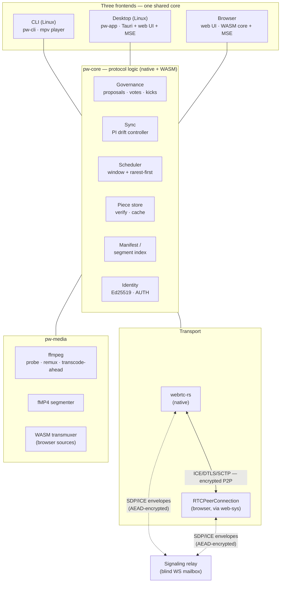
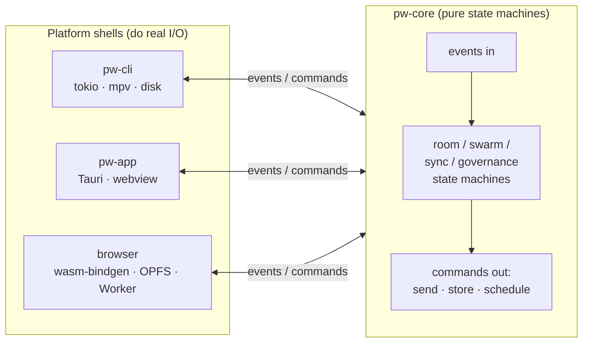

# Architecture Overview

PeerWatch is a **serverless, peer-to-peer watch party** system. A room of
people watches the same video at the same time. The video bytes, the playback
clock, the votes, and the chat all flow **directly between peers**. There is
no media server anywhere in the data path.

This document is the map of the whole system. Every other document zooms
into one box drawn here.

---

## 1. Terminology

These words have precise meanings everywhere in the codebase and docs:

| Term | Meaning |
|------|---------|
| **Room** | A group of peers watching together, identified by an invite token. Rooms are ephemeral: they exist as long as ≥1 peer is present. |
| **Peer** | Any participant — a browser tab, a desktop app, or a CLI process. All peers run the same protocol and are equal citizens: everyone downloads, verifies, re-shares, votes. |
| **Host** | The peer whose file is **currently playing**. The Host is (a) the authoritative *source* of pieces nobody else has yet, and (b) the *clock authority* whose play/pause/seek the room follows. The Host is chosen by proposal + vote and changes over the room's lifetime. |
| **Room creator** | The peer that generated the invite token. Has **no privileges whatsoever**. Creating a room and hosting a video are unrelated roles. |
| **Complete peer** | A peer holding 100% of the pieces of the current video. Complete peers are takeover candidates if the Host leaves (see [sync.md](sync.md)). |
| **Content** | One video being shared, identified by its **content ID** = `blake3(manifest)`. |
| **Swarm** | The set of peers exchanging pieces of one content. (In practice: the whole room, minus peers in FREE_ROAM who are still members.) |
| **Signaling relay** | A tiny WebSocket server that introduces peers (exchanges connection bootstrap data). Sees only encrypted envelopes, never sees video, chat, or keys. |

Three granularity levels for data (defined once, used everywhere):

| Level | Size | Role |
|-------|------|------|
| **Segment** | ≈ 4 s of media (1–10 MB) | **Playback unit.** Keyframe-aligned, what players consume, what seeks land on. |
| **Piece** | 512 KiB | **Integrity unit.** SHA-256 hashed, tracked by bitfields, the "chunk" of the swarm. |
| **Block** | 64 KiB | **Request unit.** One request = one block, one block = one DataChannel message. 8 blocks = 1 piece. |

---

## 2. The one rule that shaped everything: the browser is a full peer

A watch party with three frontends sounds like a UI problem. It isn't. It's
a *protocol* problem, because of one hard constraint:

> **A web page cannot open a raw TCP or UDP socket.** The only way for a
> browser to talk directly to another machine is **WebRTC** (or the newer
> WebTransport).

Since browser peers must download *and upload* pieces (they are full
citizens, not thin viewers), the entire P2P stack (chunking, hashing,
scheduling, voting, syncing) must run inside the browser. And since native
peers must talk to browser peers, **native peers must speak WebRTC too**.

Consequences:

1. **Transport = WebRTC everywhere.** Native side uses `webrtc-rs` (a
   pure-Rust WebRTC stack), browser side uses the built-in
   `RTCPeerConnection` via WASM bindings. Same over-the-wire protocols
   (ICE/DTLS/SCTP), so native and browser peers interoperate directly.
   Details: [connectivity.md](connectivity.md).
2. **Language = Rust.** The core protocol code must compile to *both* native
   machine code (CLI/desktop) and WebAssembly (browser). Rust is the only
   mainstream language with first-class support for both targets from one
   codebase. (Go's WASM story is too poor to run a P2P stack in a browser.
   Go would have meant writing the whole system twice.)
3. **Media format = something a browser can stream.** Browsers can't play
   sparse files, they stream via **MSE** (Media Source Extensions), which
   consumes small keyframe-aligned **segments**. The canonical wire format is
   therefore **fragmented MP4 (H.264/AAC)**, which mpv also plays natively,
   so CLI/desktop consume the *same bytes*. Details:
   [media-pipeline.md](media-pipeline.md).

---

## 3. System diagram



Solid lines are the **data plane** (P2P, encrypted, serverless). Dotted lines
are the **control bootstrap** (signaling, the only centralized component,
and it is a blind relay).

---

## 4. The two planes

### 4.1 Control plane (small messages, big consequences)

Carried on the `control` DataChannel of each peer connection:

- **Identity**: handshake, authentication ([identity.md](identity.md))
- **Room state**: roster, current video, snapshots for late joiners
- **Governance**: proposals, votes, kicks ([governance.md](governance.md))
- **Swarm metadata**: manifest, bitfields
- **Sync**: the Host's clock broadcasts ([sync.md](sync.md))
- **Chat** and presence

Every control message is **Ed25519-signed** by its sender and verified by
every receiver independently. Nobody trusts anybody's word about a third
party. They trust signatures.

### 4.2 Data plane (the video itself)

Carried on the `data` DataChannel of each peer connection:

- **Block requests** (batched, pipelined) and **block payloads**
- Blocks are assembled into pieces, pieces are SHA-256-verified against the
  manifest, verified pieces feed the local player *and* become available for
  upload to other peers.

Full details: [distribution.md](distribution.md).

---

## 5. The shared-core design (how one codebase serves three platforms)

The single most important structural discipline in the repo:

> **`pw-core` performs zero I/O.** No sockets, no files, no clocks, no RNG
> of its own. Everything external (sending a message, reading a piece from
> disk, "what time is it", "wake me in 200 ms") is an **injected trait**
> implemented by the platform shell.



Why this matters:

- **WASM compatibility**: browsers have no threads/sockets in the usual
  sense. If core logic touched I/O directly it could never compile to WASM.
- **Testability**: the entire protocol can be unit-tested with a scripted
  fake network and a fake clock, deterministic, fast, no flakes.
- **No logic duplication**: the scheduler that picks blocks in the CLI is
  *the same machine code* (compiled twice) that runs in a browser tab.

---

## 6. Repository layout

```
peerwatch/
├── Cargo.toml                    # workspace root
├── crates/
│   ├── pw-core/                  # ALL protocol logic, zero I/O:
│   │                             #   envelope/manifest types, piece store logic,
│   │                             #   scheduler, sync controller, governance,
│   │                             #   identity/crypto — targets native AND wasm32
│   ├── pw-transport/             # Transport trait (connect, channels, events)
│   │   ├── src/webrtc.rs         #   native impl on webrtc-rs
│   │   └── src/web.rs            #   wasm impl on web-sys RTCPeerConnection
│   ├── pw-media/                 # ffprobe/ffmpeg subprocess pipeline (probe,
│   │                             #   remux, transcode-ahead), fMP4 segmenter;
│   │                             #   WASM transmuxer for browser-sourced files
│   ├── pw-player/                # Player trait + mpv adapter (JSON-RPC IPC +
│   │                             #   localhost range server)
│   ├── pw-signal/                # signaling client + the relay server (axum WS)
│   ├── pw-cli/                   # clap CLI; optional ratatui room interface
│   └── pw-app/                   # Tauri 2 desktop shell (Linux)
├── web/                          # shared web UI (MSE player, votes, chat,
│                                 #   free-roam controls) — served for browser
│                                 #   users AND embedded in the Tauri app
└── docs/                         # you are here
```

---

## 7. The lifecycle of a room (end to end, one paragraph each)

**Create.** Any peer generates a room ID + secret, prints an invite token
(`pw_<room_id>.<secret>`), connects to the signaling relay, and waits. The
creator is a normal peer from this moment on.

**Join.** An invitee pastes the token, derives the signaling channel and the
room PSK, connects to the relay, and (via relayed, AEAD-encrypted envelopes)
establishes direct encrypted WebRTC connections to **every** existing peer
(full mesh). Each connection runs the AUTH handshake (proof of key possession
+ room membership). The joiner receives the manifest (if a video is active)
and room state. See [connectivity.md](connectivity.md).

**Propose.** Any peer with a local file may broadcast a `PLAY_VIDEO`
proposal carrying the video's manifest. If the file's codecs aren't
browser-compatible, a native peer first sets up a remux/transcode-ahead
pipeline so that what gets shared is the canonical stream. See
[media-pipeline.md](media-pipeline.md).

**Vote.** Peers broadcast signed votes. On strict majority, the proposer
becomes **Host**, distributes the manifest to anyone missing it, and, after a
short buffering gate, broadcasts a synchronized `START_AT`. See
[governance.md](governance.md).

**Watch.** The Host plays its local file, its position is broadcast every
second. All peers fetch pieces (playback window first, rarest-first after),
feed their players, and follow the Host's clock with a PI drift controller.
Any peer may drop into **free-roam** (local pause/seek without affecting the
room) and later **return to live**. See [sync.md](sync.md).

**Host leaves.** Playback continues on pieces the swarm collectively holds.
If a complete peer exists, it deterministically takes over as Host. Otherwise
the room stalls at the missing frontier and may wait for the Host's return or
vote in a new video. See [sync.md](sync.md) §6.

---

## 8. What is deliberately NOT here

- **No accounts, no serverside state, no database.** Identity is a local
  keypair. Rooms exist only in the peers' memories.
- **No DHT / trackerless discovery.** Rendezvous goes through the signaling
  relay (or manual token exchange fallback). A DHT is a poor fit for
  small, secret, ephemeral rooms.
- **No centralized moderation.** Kicks and host changes are signed majority
  votes executed identically by every peer.
- **No support for huge swarms in v1.** Full mesh targets ≈ 5–16 peers. The
  protocol leaves room for partial mesh later ([roadmap.md](roadmap.md)).
