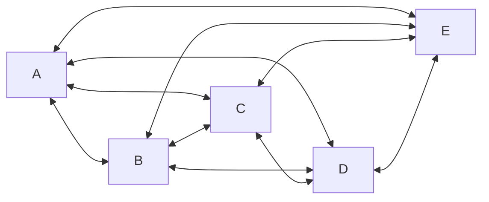
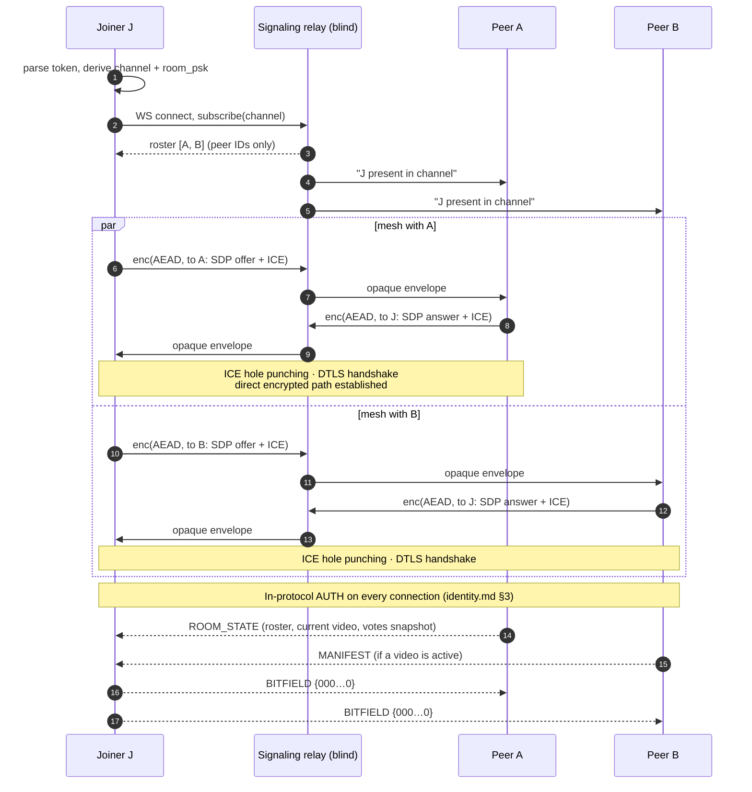

# Connectivity — How Peers Find and Reach Each Other

This document explains, from zero prior knowledge, how two computers on the
internet manage to talk directly to each other, and why PeerWatch does it
the way it does. It covers: the NAT problem, WebRTC's four building blocks
(SDP, ICE, STUN/TURN, DTLS/SCTP), the signaling relay, the full-mesh
topology, and the exact join sequence.

---

## 1. The problem: NAT

Almost every device sits behind a **NAT** (your home router does NAT). NAT
lets your device make *outbound* connections: your router rewrites your
private address (`192.168.x.y`) into its public one and remembers the mapping
so replies come back to you. But an *unsolicited inbound* packet has no
mapping and is dropped.

Consequence: two peers behind NATs **cannot simply connect to each other**.
This is why the Go v1 of PeerWatch (raw TCP) only worked on LANs or with
manual port forwarding. A truly P2P internet application must solve NAT
traversal. The industry-standard, browser-built-in solution is **WebRTC**.

> Why WebRTC and not something simpler? Because browsers *only* ship WebRTC
> for P2P. There is no "open a UDP socket" API in a web page. WebRTC is the
> common denominator, so native peers speak it too, via `webrtc-rs`.

---

## 2. WebRTC's four building blocks

WebRTC looks intimidating, but it decomposes into four small ideas.

### 2.1 SDP — "here is how to reach me"

Before two peers can connect, each must generate an **SDP (Session
Description Protocol)** blob: a text document describing itself: "I support
DataChannels, here are my crypto fingerprints, here are the network
addresses where I might be reachable." One side produces an **offer**, the
other an **answer**. WebRTC does not specify *how* these blobs travel. That
exchange (called **signaling**, §3) is up to the application.

### 2.2 ICE candidates — "here are all my possible addresses"

A peer typically doesn't know its own public address. So it gathers a list
of **ICE candidates**, each a `ip:port` where it *might* be reachable:

- **host candidate** — its LAN address (works on the same network),
- **server-reflexive candidate** — its public NAT-mapped address, learned by
  asking a **STUN server** (§2.3),
- **relayed candidate** — an address on a **TURN relay** (§2.4), the last
  resort.

Both peers exchange candidates (this also happens over the signaling
channel) and then **try all pairs simultaneously**. The trick that defeats
NAT is **UDP hole punching**: if peer A sends a UDP packet to peer B's public
address *at the same time* B sends one to A's, each NAT sees its own device
making an "outbound" packet and opens a pinhole for the reply. Both packets
get through, and the peers now have a working direct path: no port
forwarding, no router config.

ICE tries pairs in priority order and picks the first that works
(host > server-reflexive > relayed).

### 2.3 STUN — "what is my public address?"

A **STUN server** is a nearly trivial UDP service: you ping it, it replies
"the packet came from `203.0.113.7:51234`". That answer *is* your
server-reflexive candidate. STUN is stateless, sees nothing but UDP pings,
and is cheap to run. Public instances exist (e.g. Google's). Self-hosting
`coturn` gives you STUN in a two-line config. PeerWatch treats the STUN
server list as ordinary configuration with sane public defaults.

### 2.4 TURN — the relay of last resort

For roughly 10–15 % of peer pairs (symmetric NATs, some corporate
firewalls), hole punching fails. The fallback is a **TURN server**, which
relays the traffic. Note well: even relayed traffic stays **end-to-end
encrypted** (§2.5). The relay moves ciphertext it cannot read.

**PeerWatch v1 ships TURN as optional configuration.** Without a configured
TURN server, unlucky pairs fail with a clear error message ("direct
connection to peer X impossible. Consider configuring TURN"). We do not
silently relay through strangers' infrastructure.

### 2.5 DTLS + SCTP — security and messaging on top

Once ICE finds a working path, WebRTC automatically layers on:

1. **DTLS handshake**: TLS adapted to datagrams. Both sides present
   self-signed certificates whose fingerprints were pinned inside the
   (authenticated) SDP exchange, so the handshake is mutually authenticated
   and everything after it is encrypted. **Transport encryption is free**,
   a major upgrade over v1's plaintext TCP.
2. **SCTP association** — a message-oriented transport (unlike TCP's byte
   stream) with configurable reliability/ordering per channel.
3. **DataChannels** — named logical channels over SCTP. One message sent =
   one message delivered.

PeerWatch opens **two DataChannels per peer connection**:

| Channel | Ordering | Carries |
|---------|----------|---------|
| `control` | reliable, ordered | handshake, room state, manifest, bitfields, votes, chat, sync, pings |
| `data` | reliable, **unordered** | block requests, block payloads, cancels |

The `data` channel is deliberately unordered: a lost block message only
needs its own retransmission, not head-of-line blocking of the 40 blocks
queued behind it.

---

## 3. Signaling: the one thing WebRTC can't do

WebRTC deliberately omits any mechanism for the initial exchange of SDP and
ICE candidates. That bootstrap (called **signaling**) requires *some*
pre-existing channel between the peers.

PeerWatch uses a **tiny signaling relay**: a ~200-line WebSocket service
(`pw-signal`, also deployable as a serverless Worker). Its entire job:

1. Let peers subscribe to a **channel** (a room mailbox) by name.
2. Forward opaque envelopes between peer IDs within a channel.
3. Notify channel members of joins and leaves.

### 3.1 Why the relay learns nothing

The invite token (see [identity.md](identity.md)) is
`pw_<room_id>.<secret>`. From it, every invitee derives via HKDF:

- `channel = blake3("pw-channel" ‖ room_id)` — the mailbox name,
- `room_psk` — a pre-shared key used to **AEAD-encrypt every signaling
  envelope** and to authenticate the in-protocol handshake.

The relay therefore sees: channel names (hashes, useless without the room
ID), and ciphertext addressed to peer IDs it cannot map to humans. It cannot
read the SDP, cannot join the room, cannot correlate rooms to users. It is a
**blind mailbox**, exactly like a BitTorrent tracker: operationally
centralized, cryptographically irrelevant.

### 3.2 Why not fully serverless signaling?

The alternative is manual copy-paste: each joiner would paste an offer token
to an existing member and paste an answer token back (two out-of-band
exchanges per join, ~2 KB blobs). It works, and the code keeps the
envelope format transport-agnostic so a manual fallback *can* be added, but
for rooms of 3+ people the UX is poor. The relay is the default. It is
self-hostable in one command and holds no data.

---

## 4. Topology: full mesh

Every peer holds **one RTCPeerConnection to every other peer**:
`N·(N−1)/2` connections for N peers (10 peers → 45). A WebRTC connection is
heavier than a TCP socket (each carries an ICE/DTLS/SCTP stack), but
~15 connections per client is comfortable both in browsers and natively.
**Target room size for v1: 5–16 peers.**

The protocol itself does not *assume* full connectivity (bitfields,
requests, and gossip work over any connected graph), so a **partial mesh**
(connect to a random subset, gossip through the graph) can be introduced
later without breaking changes. Full mesh is simply the best latency and
simplicity at watch-party scale. See [roadmap.md](roadmap.md).

---

## 5. The join sequence, step by step

Points of note:

- The **joiner initiates** an offer to every existing peer. Answers come
  back through the relay. ICE candidates may trickle both ways for a few
  seconds after the initial exchange.
- The relay's only state is: channel → set of connected peer IDs. Rooms
  whose last member disconnects vanish from the relay's memory.
- Late joiners while a video is playing receive the **manifest and current
  playback position** immediately after AUTH, buffer a few segments, and
  land in sync via the normal drift controller
  ([sync.md](sync.md)).
- Peers stay connected to the relay (cheap: a ping every 30 s) so late
  joiners can be admitted and dropped connections re-established.

---

## 6. Disconnects and reconnects

- **Clean exit**: a peer sends `BYE` on its control channels, then closes.
  Peers remove it from the roster instantly.
- **Unclean exit** (crash, network drop): WebRTC's own connectivity checks
  detect the dead path (consent freshness timeouts, typically 5–15 s). The
  peer is removed from the roster and from the scheduler's candidate set.
- **Rejoin**: same install → same Ed25519 key → same **peer ID**. The
  room recognizes a returning peer (and, if it was the Host, may let it
  resume, see [sync.md](sync.md) §6). Its persisted bitfield means it keeps
  every piece it already had ([storage.md](storage.md)).
- **Relay flaps**: if the relay connection drops but the mesh is intact,
  the room keeps working indefinitely. The relay is only needed for *new*
  joins and reconnect signaling. Clients retry with backoff and surface
  "relay unreachable: new peers cannot join right now" in the UI.

---

## 7. Failure modes and what the user sees

| Situation | Detection | Behavior |
|-----------|-----------|----------|
| STUN unreachable | ICE gathering yields host candidates only | Same-LAN peers still connect, remote peers get a clear warning |
| Pair behind symmetric NATs, no TURN | ICE checks all fail (~5–10 s) | "Cannot establish a direct link to `pw:…`. Configure a TURN server or try a different network." |
| Relay down at join time | WS connect failure | Join fails fast with relay address shown, retry/backoff |
| Relay down mid-room | WS ping timeout | Room continues, warning "new peers cannot join" |
| Single peer connection dies mid-room | ICE consent timeout | Roster shrinks, if it was the Host → host-leave procedure ([sync.md](sync.md) §6) |

---

## 8. Sizing notes

Per-connection costs that bound room size:

- DTLS-SCTP stack: tens of KB of state, ~1 timer wheel each, negligible at 16 peers.
- Control traffic: bitfield broadcast every 1 s, Roaring-compressed
  ([roaring-compression.md](roaring-compression.md)); ~0.3–0.5 KB/peer, a few
  KB/s room-wide at 16 peers (was ~24 KB/s raw). Trivial.
- Data traffic: dominated by the video bitrate, **not** the mesh degree.
  Each peer downloads the stream once (≈ video bitrate) and uploads at a
  rate the scheduler caps by policy (default ≈ 1.5× video bitrate to keep
  fan-out healthy). Details in [performance.md](performance.md).
