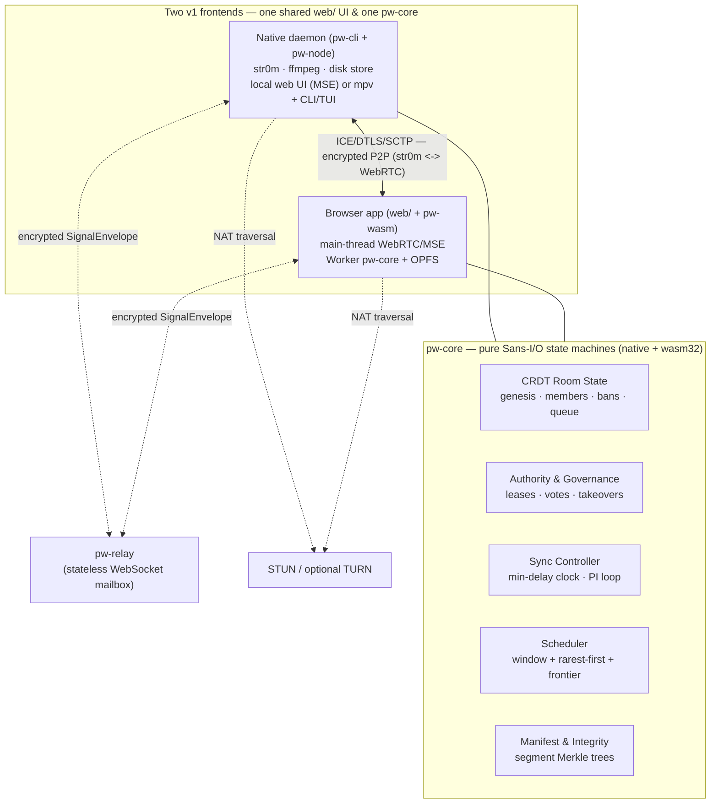
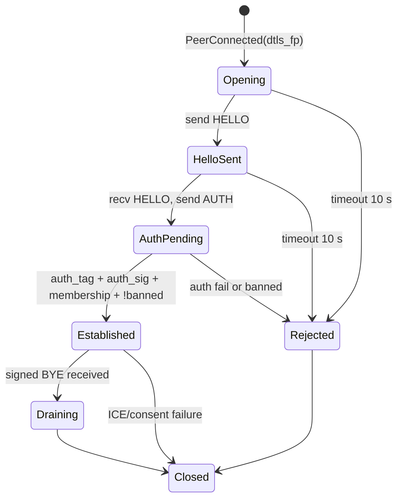
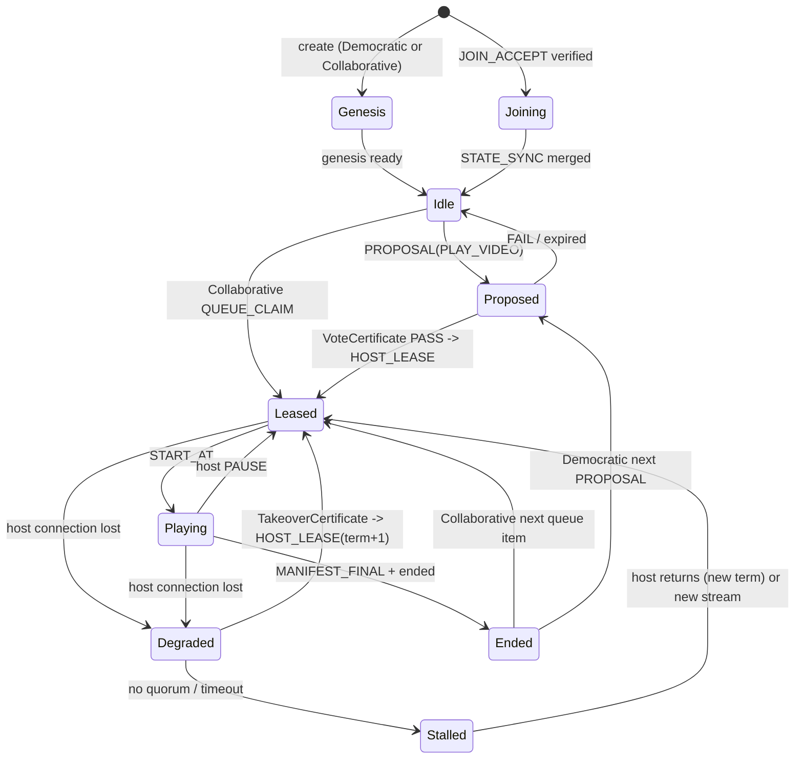
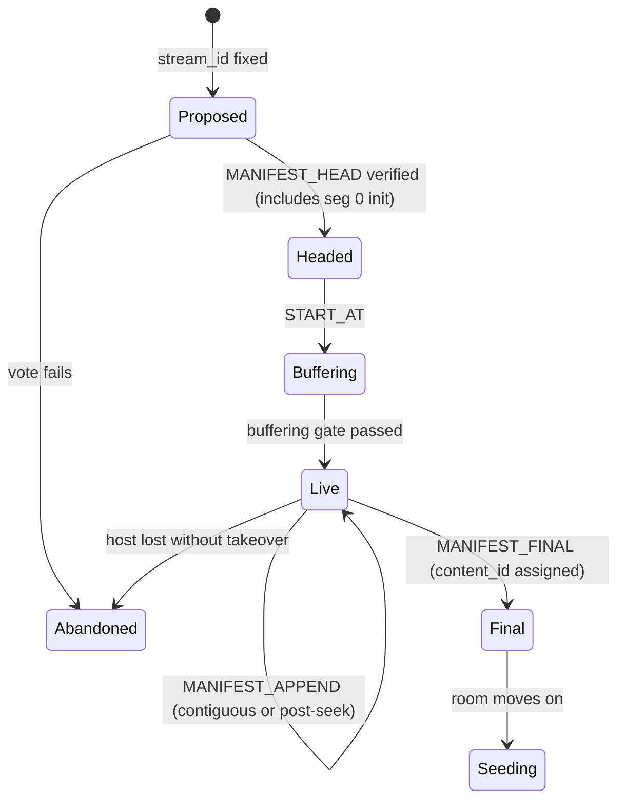
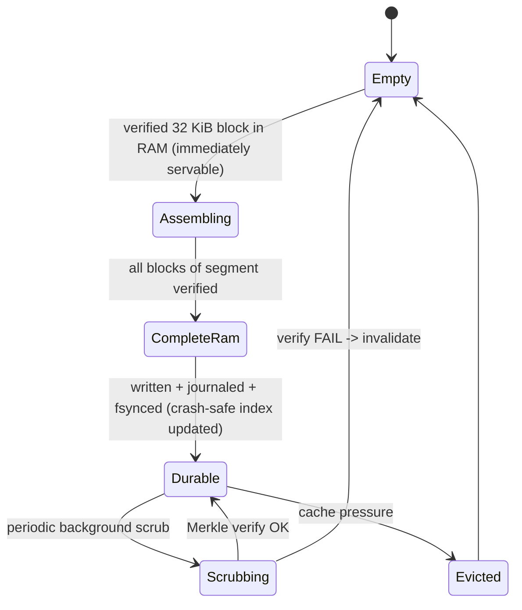
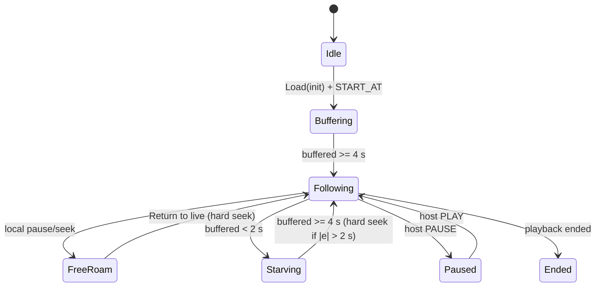

# Architecture Overview

PeerWatch v3 is a **serverless, peer-to-peer watch party**. A group of 5–16
people joins an ephemeral room, chooses videos democratically (or adds them to
a shared collaborative queue), and distributes the video BitTorrent-style over
encrypted WebRTC while playing back in lockstep. There is no media server, no
account database, and no persistent server state.

This document is the map of the system. Normative wire formats live in
[protocol.md](../spec/protocol.md).

---

## 1. Terminology

| Term | Meaning |
|------|---------|
| **Room** | An ephemeral watch party identified by a random `room_id` and a `room_secret`, configured in either `DEMOCRATIC` or `COLLABORATIVE` mode at genesis. |
| **Peer** | Any participant — a browser tab (`pw-wasm`) or a native daemon (`pw-cli` / `pw-node`). Both run the full protocol (download, verify, upload, vote). |
| **Host** | The peer holding the current `HostLease` for `(stream_id, term)`. It is the authoritative source for new manifest segments and the single playback clock authority. |
| **Host lease / term** | Signed proof (`VoteCertificate`, `TakeoverCertificate`, or `QueueClaim`) authorizing one Host per monotonic `term`. |
| **Room state (CRDT)** | A join-semilattice (set union + max term) of self-verifying signed records (`RoomGenesis`, `MemberAdd`, `KickCertificate`, `HostLease`, `QueueEvent`, `PeerSignalKey`). |
| **Stream** | One shared video identified by a random 128-bit `stream_id`. `content_id` is derived only on `MANIFEST_FINAL`. |
| **Signaling relay** | A 100% stateless in-memory WebSocket mailbox (`pw-relay`) that routes opaque encrypted envelopes between aliases. |
| **Invite** | A signed, expiring, usage-capped capability (`pw3_<room_id>.<invite_id>.<secret>`). |

Two data granularity levels (aligned cleanly to media playback):

| Level | Size | Role |
|-------|------|------|
| **Segment** | ≈ 4 s (keyframe-aligned, variable byte length) | **Playback, integrity, and availability unit.** Segment `0` is the init segment (`ftyp+moov`); `1..=N` are media segments (`moof+mdat`). Each segment has a BLAKE3 Merkle root (`segment_root`). |
| **Block** | ≤ 32 KiB | **Request, transfer, and Merkle leaf unit.** One block = one DataChannel message carrying its Merkle proof to `segment_root`. |

---

## 2. Core constraint: the browser is a full peer

Because a web page cannot open raw TCP or UDP sockets, **WebRTC is the sole
peer-to-peer transport everywhere**. Native peers speak WebRTC via **`str0m`**
(a pure-Rust, Sans-I/O WebRTC implementation), and browsers use their built-in
`RTCPeerConnection`.

Consequences:

1. **One Rust core (`pw-core`) for native and WASM.** Pure Sans-I/O state
   machines compile to native machine code and `wasm32-unknown-unknown`.
2. **One canonical wire format: fragmented MP4 (H.264/AAC).** Browsers play
   keyframe-aligned segments through MSE; `mpv` plays the identical bytes via
   a localhost HTTP range server. WebM (VP9/Opus) is supported when every peer
   declares WebM support.
3. **Browser thread split.** `RTCPeerConnection` and MSE live on the main
   thread; `pw-core` (WASM), crypto, block verification, and OPFS synchronous
   storage live in a Web Worker, bridged by transferable `ArrayBuffer`s.
4. **Two v1 frontends sharing one `web/` UI.** Browser users run zero-install
   WASM; native users run the single `peerwatch` daemon, which serves the same
   `web/` UI locally to the user's real browser (hardware-accelerated MSE with
   zero WebKitGTK codec issues) and/or drives `mpv` natively. Tauri desktop
   packaging moves to v2 as a thin wrapper over the daemon.

---

## 3. System diagram



---

## 4. Control plane and data plane

- **Control plane (`control`, reliable ordered)**: `HELLO`/`AUTH`,
  `STATE_DIGEST`, `HOST_LEASE`, `PEER_SIGNAL_KEY`, `PRESENCE`, `AVAILABILITY`,
  `SYNC`, `START_AT`, `CONTROL_REQ`, proposals, votes, queue events, chat.
- **Bulk plane (`bulk`, reliable ordered)**: `STATE_SYNC` batches,
  `MANIFEST_HEAD`/`CHUNK`/`GET`/`APPEND`/`FINAL`, WebVTT subtitles.
- **Data plane (`data`, reliable unordered)**: `REQUEST`, `BLOCK`, `CANCEL`,
  `CHALLENGE_RESPONSE`.

All three channels share one SCTP congestion window, so shells report
**aggregate** `bufferedAmount` across `data` + `bulk` and pause lower-priority
writes above 256 KiB so `SYNC` and `PING` stay responsive.

---

## 5. Pure Sans-I/O core and state machines

`pw-core` performs **zero I/O**: no sockets, files, clocks, threads, or ambient
RNG. Every external interaction crosses `handle(&mut self, Event) ->
Vec<Command>` ([core-api.md](../spec/core-api.md)).

### 5.1 The five state machines

#### 5.1.1 Peer connection



#### 5.1.2 Room



#### 5.1.3 Stream



#### 5.1.4 Segment store



#### 5.1.5 Local playback



---

## 6. Workspace layout (6 crates)

```
peerwatch/
├── Cargo.toml
├── crates/
│   ├── pw-core/     # pure Sans-I/O protocol, canonical CBOR, crypto, CRDT state,
│   │                #   manifest/Merkle, scheduler, sync, errors (native + wasm32)
│   ├── pw-wasm/     # wasm-bindgen Worker bridge + OPFS pack store
│   ├── pw-node/     # native Tokio runtime: str0m WebRTC, disk store, ffmpeg,
│   │                #   mpv adapter, local HTTP/WS server, signaling client
│   ├── pw-cli/      # `peerwatch` binary: daemon + local web UI host + CLI/TUI
│   ├── pw-relay/    # stateless axum WebSocket signaling mailbox
│   └── pw-sim/      # deterministic multi-peer simulator & property tests
├── web/             # shared UI (Browser WASM mode & Native Daemon local mode)
├── scripts/         # catalog generator & invariant linter
└── docs/            # v3 specification & guides
```

`pw-core` and `pw-wasm` depend on zero native I/O crates (`tokio`, `axum`,
`str0m`, `std::process`, or filesystem APIs never enter the WASM graph).

---

## 7. Room lifecycle end to end

1. **Create**: Creator picks `DEMOCRATIC` or `COLLABORATIVE` mode, generates
   `room_id`, `room_secret`, signed `RoomGenesis`, and signed `InviteGrant`s
   (`pw3_...`).
2. **Join**: Invitee sends an encrypted `InviteEnvelope` (zero cleartext room
   metadata) over `invite_channel`, receives `JoinAccept` with `room_secret`
   and signed room records, subscribes to `room_channel`, and embeds its
   `MemberAdd` + self-signed `signal_pub` inside its first `SignalEnvelope` so
   every peer can answer immediately without deadlock.
3. **Connect & Sync State**: Direct `str0m`/WebRTC links run single-signature
   DTLS-bound `AUTH`, then reconcile CRDT room records via `STATE_DIGEST` /
   `STATE_SYNC`.
4. **Select Media**: In `DEMOCRATIC` mode, a peer proposes a file, peers check
   live codec compatibility (`PROPOSAL_COMPAT`), vote, and the winner mints
   `HOST_LEASE(term+1)`. In `COLLABORATIVE` mode, anyone adds items to the
   shared queue and the next owner claims `HOST_LEASE(term+1)`.
5. **Watch**: Host plays and sends `SYNC` (1 Hz + events; forwarding member
   `CONTROL_REQ`s in `COLLABORATIVE` mode). Peers fetch 32 KiB blocks verified
   against `segment_root`, serve verified blocks from RAM immediately, play via
   MSE or `mpv`, and track the clock via a retuned PI controller (±5% clamp,
   2 s hard-seek).
6. **Host Loss / Kick**: Host departure runs a clean 2-step challenge +
   majority `TAKEOVER_ACK` handover. A passed `KICK` vote adds a self-verifying
   `KickCertificate` to the CRDT banlist; every peer disconnects and rejects
   the banned key permanently.
