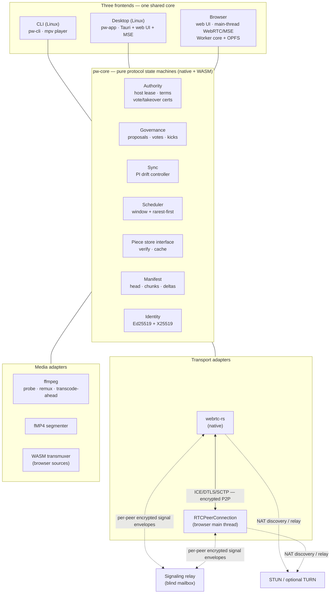
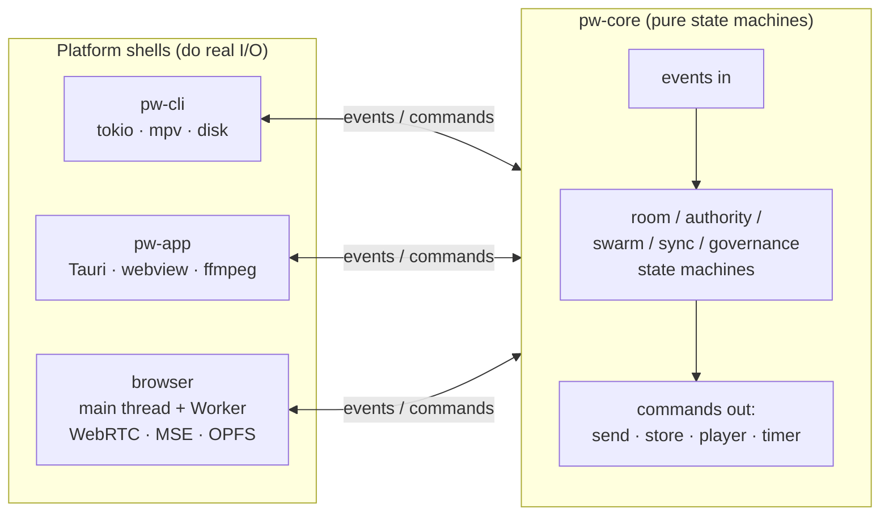
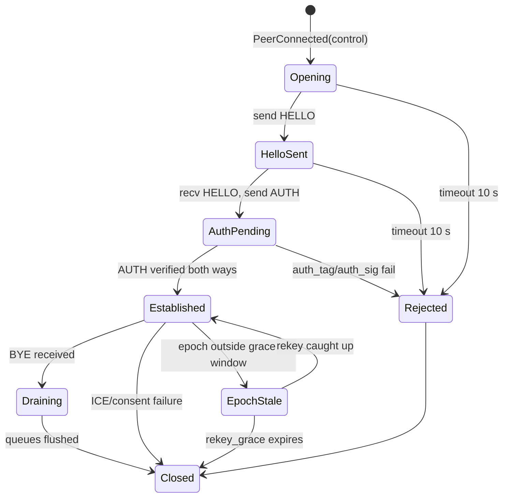
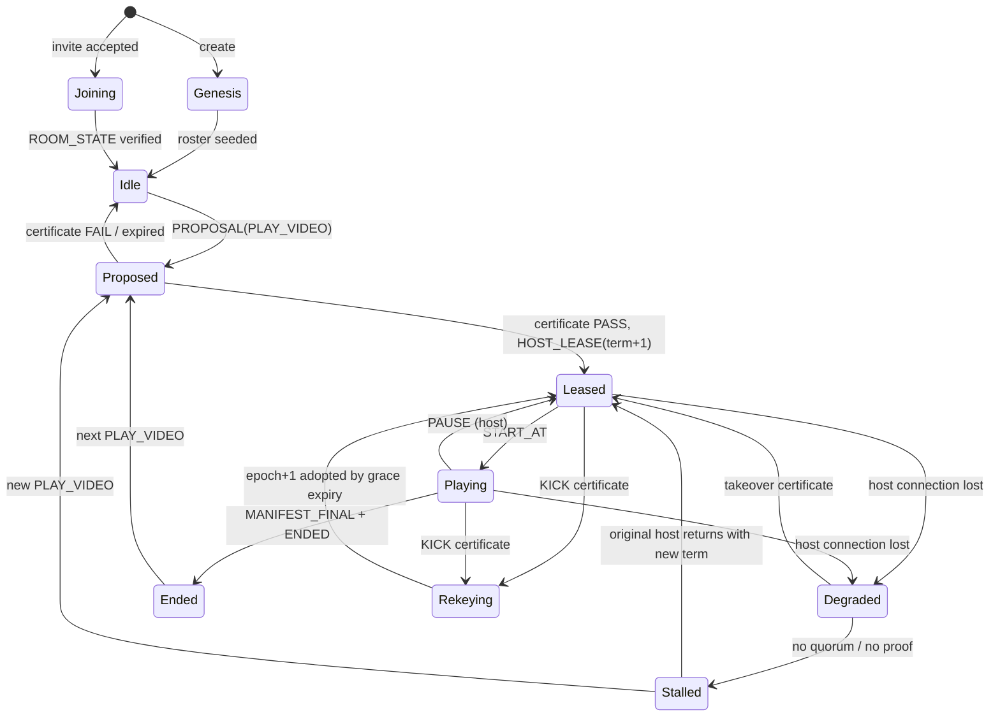
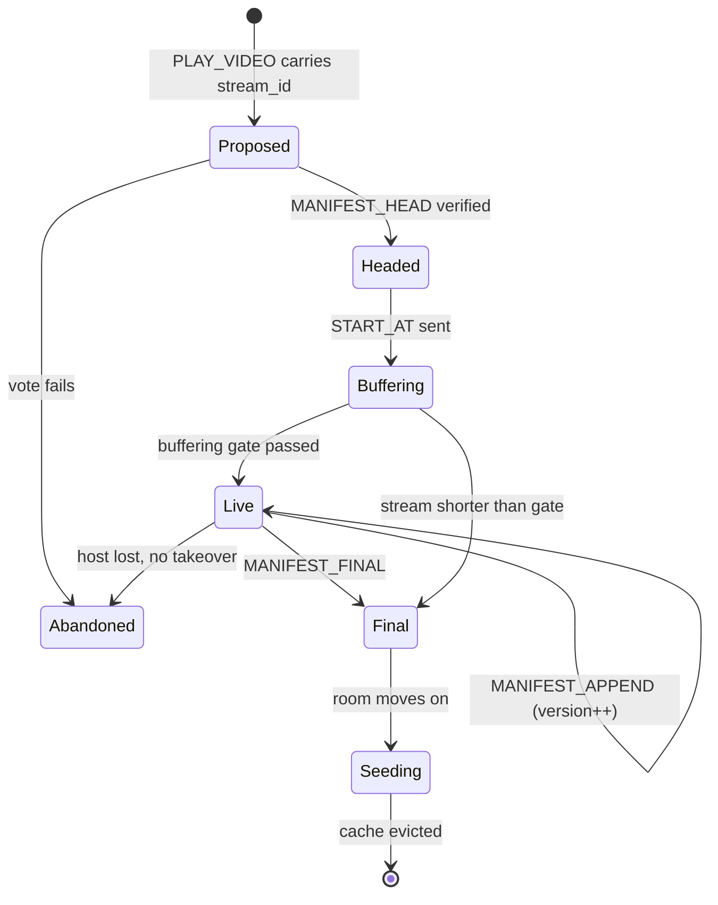
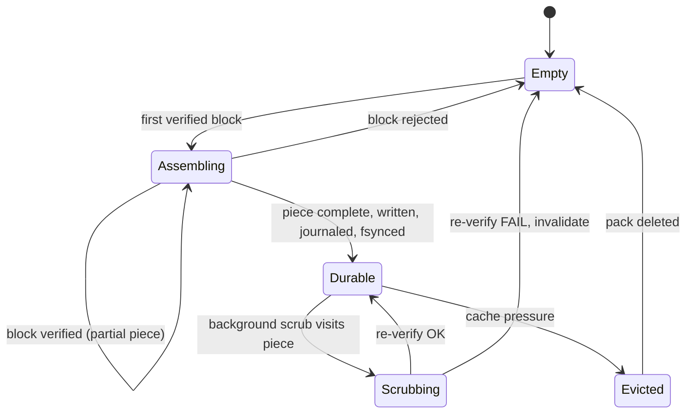
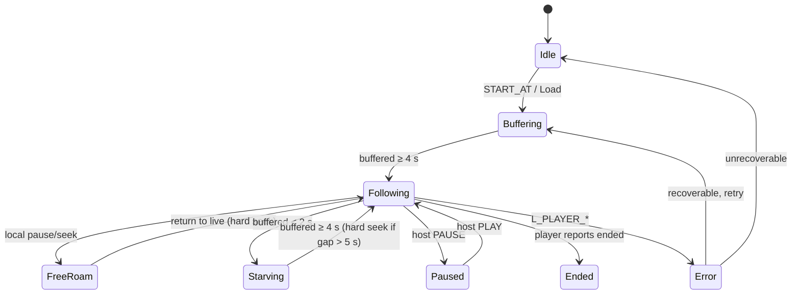

# Architecture Overview

PeerWatch is a **serverless, peer-to-peer watch party** system. A room of
people watches the same video at the same time. The video bytes, the playback
clock, the votes, and the chat all flow **directly between peers**. There is
no media server anywhere in the data path.

This document is the map of the whole system. Every other document zooms
into one box drawn here. The normative wire definitions live in
[protocol.md](../spec/protocol.md); when this document and the schema
disagree, the schema wins.

---

## 1. Terminology

These words have precise meanings everywhere in the codebase and docs:

| Term | Meaning |
|------|---------|
| **Room** | A group of peers watching together, identified by a random `room_id` and a rotating room key. Rooms are ephemeral: they exist as long as ≥1 peer is present. |
| **Peer** | Any participant — a browser tab, a desktop app, or a CLI process. All peers speak the same protocol and are full participants: everyone downloads, verifies, re-shares, votes. Storage and proposal capabilities are asymmetric and advertised in `Caps`. |
| **Host** | The peer that holds the current **host lease**: it is the authoritative source for new pieces and the clock authority whose play/pause/seek the room follows. A lease is scoped to `(stream_id, term)`. |
| **Host lease / term** | The signed proof that a peer is allowed to be Host. `term` increases on every host change. Authority messages (`SYNC`, `START_AT`, `MANIFEST_HEAD/APPEND/FINAL`) are accepted only from the lease holder for the current term; `MANIFEST_CHUNK`/`GET` may be served by any peer. |
| **Room creator** | The peer that generated the room genesis and first invite. Has **no privileges whatsoever** after genesis. Creating a room and hosting a video are unrelated roles. |
| **Complete peer** | A peer holding 100% of the *currently known* pieces of the current stream. Complete peers are takeover candidates if the Host leaves, but only a peer that proves possession and obtains a majority certificate can take over. |
| **Stream** | One video being shared, identified by a stable random `stream_id`. The final `content_id` is derived only after `MANIFEST_FINAL`. |
| **Swarm** | The set of peers exchanging pieces of one stream. Free-roam peers remain in the swarm: they still download, verify, upload, and vote. |
| **Signaling relay** | A tiny WebSocket mailbox that introduces peers (exchanges encrypted connection bootstrap data). Sees only aliases, ciphertext, sizes, and timing; never sees video, chat, room keys, or plaintext SDP. |
| **Invite** | A signed, expiring capability (`pw1_<room_id>.<invite_id>.<secret>`) that admits one peer. Possession of an invite is not the same as possession of the room key. |
| **Room key / epoch** | A symmetric key shared by current members, versioned by `epoch`. A kick rotates the key and the relay channel, so the kicked peer loses access even if it keeps the old invite. |

Three granularity levels for data (defined once, used everywhere):

| Level | Size | Role |
|-------|------|------|
| **Segment** | ≈ 4 s of media (1–10 MB) | **Playback unit.** Keyframe-aligned, what players consume, what seeks land on. |
| **Piece** | 512 KiB = 16 blocks | **Integrity/bitfield unit.** Merkle root per piece, tracked by bitfields, the "chunk" of the swarm. |
| **Block** | 32 KiB | **Request/transfer unit.** One request = one block, one block = one DataChannel message. A block carries a Merkle proof to its piece root. |

The block is deliberately 32 KiB, not 64 KiB: a 32 KiB block plus its 4-hash
proof and envelope metadata fits comfortably inside the 64 KiB DataChannel
limit that browsers and `webrtc-rs` support (see
[design-log.md](design-log.md) D9 for the rejected 64 KiB variant).

---

## 2. The one rule that shaped everything: the browser is a full peer

A watch party with three frontends sounds like a UI problem. It isn't. It's
a *protocol* problem, because of one hard constraint:

> **A web page cannot open a raw TCP or UDP socket.** The only way for a
> browser to talk directly to another machine is **WebRTC**. WebTransport
> is client–server over HTTP/3; it is useful as a relay transport, not as a
> direct peer-to-peer transport.

Since browser peers must download *and upload* pieces (they are full
protocol participants, not thin viewers), the entire P2P stack (chunking,
hashing, scheduling, voting, syncing) must run inside the browser. And since
native peers must talk to browser peers, **native peers must speak WebRTC
too**.

Consequences:

1. **Transport = WebRTC everywhere.** Native side uses `webrtc-rs` (a
   pure-Rust WebRTC stack), browser side uses the built-in
   `RTCPeerConnection`. Same over-the-wire protocols (ICE/DTLS/SCTP), so
   native and browser peers interoperate directly. Details:
   [connectivity.md](connectivity.md).
2. **Language = Rust.** The core protocol code must compile to *both* native
   machine code (CLI/desktop) and WebAssembly (browser). Rust gives one
   codebase for both targets. (Go's WASM story is too heavy for a P2P stack
   in a browser; Go would have meant writing the whole system twice.)
3. **Media format = something a browser can stream.** Browsers can't play
   sparse files, they stream via **MSE** (Media Source Extensions), which
   consumes small keyframe-aligned **segments**. The canonical wire format is
   therefore **fragmented MP4 (H.264/AAC)**, which mpv also plays natively,
   so CLI/desktop consume the *same bytes*. Details:
   [media-pipeline.md](media-pipeline.md).
4. **Browser process split.** `RTCPeerConnection` and MSE are main-thread
   APIs; OPFS sync access and CPU-heavy verification/scheduling belong in a
   Worker. The browser architecture is therefore **main thread = network +
   player, Worker = core + crypto + storage**, with a transferable-buffer
   bridge. Details: [frontends.md](frontends.md) §2.

---

## 3. System diagram



Solid lines are the **data plane** (P2P, encrypted, serverless). Dotted lines
are the **control bootstrap** (signaling and NAT discovery). The relay is
blind to plaintext; STUN sees only address discovery; TURN sees only
encrypted WebRTC packets.

---

## 4. The two planes

### 4.1 Control plane (small messages, big consequences)

Carried on the `control` DataChannel of each peer connection:

- **Identity**: HELLO/AUTH handshake ([identity.md](identity.md))
- **Room state**: host lease, roster, current stream, banlist, snapshots
- **Governance**: proposals, votes, vote certificates, kicks
- **Swarm metadata**: manifest head, bitfields
- **Sync**: the Host's clock broadcasts
- **Chat** and presence

Not every control message is signed. The rule is:

- **Authoritative/state-changing messages are signed and authorized**:
  `AUTH`, `ROOM_STATE`, `HOST_LEASE`, `MANIFEST_HEAD/APPEND/FINAL`,
  `SYNC`, `START_AT`, `STALL_NOTICE`, `TAKEOVER_*`, `PROPOSAL`, `VOTE`,
  `VOTE_CERT`, `KICK_NOTICE`, `BAN_REPORT`, `CHAT`, `REKEY`.
- **Liveness/availability/data messages are unsigned**: `HELLO`, `PING`,
  `PONG`, `BYE`, `BITFIELD`, `REQUEST`, `BLOCK`, `CANCEL`, `READY`, `PRESENCE`,
  `MANIFEST_CHUNK`, `MANIFEST_GET`, `CHALLENGE`, `CHALLENGE_RESPONSE`.

Signatures prove *authorship*. They do not prove *authority*. Host changes,
kicks, banlists, and takeovers are accepted only with a valid certificate
and the current term ([protocol.md](../spec/protocol.md) §5). A
malicious member can sign a `SYNC`, but it cannot make that `SYNC`
authoritative unless it holds the current host lease.

### 4.2 Data plane (the video itself)

Carried on the `data` DataChannel of each peer connection:

- **Block requests** (batched, pipelined), **block payloads**, and
  **cancels**.
- Blocks carry a Merkle proof against the piece root; a receiver verifies
  each block immediately and attributes a bad block to the exact sender.
- Verified blocks assemble into pieces, pieces assemble into segments, and
  segments feed the local player *and* become available for upload.
- A separate `bulk` channel carries manifest chunks and appends so a large
  manifest cannot head-of-line-block sync or votes.

Full details: [distribution.md](distribution.md).

---

## 5. The shared-core design (how one codebase serves three platforms)

The single most important structural discipline in the repo:

> **`pw-core` performs zero I/O.** No sockets, no files, no clocks, no RNG
> of its own. Everything external (sending a message, reading a piece from
> disk, "what time is it", "wake me in 200 ms") is an **injected capability**
> or a **command** implemented by the platform shell.



`pw-core` exposes a synchronous, deterministic state machine:

```rust
fn handle(&mut self, event: Event) -> Vec<Command>;
```

The full `Event`/`Command` vocabulary is normative in
[core-api.md](../spec/core-api.md). The shell executes commands and feeds
resulting events back. This avoids `async fn` in core traits (which is not
object-safe), makes the scheduler testable with a fake network and clock,
and keeps WASM builds free of native I/O.

Why this matters:

- **WASM compatibility**: browsers have no threads or raw sockets in the
  usual sense. If core logic touched I/O directly it could never compile to
  WASM.
- **Testability**: the entire protocol can be unit-tested with a scripted
  fake network and a fake clock, deterministic, fast, no flakes.
- **No logic duplication**: the scheduler that picks blocks in the CLI is
  *the same machine code* (compiled twice) that runs in a browser tab.
- **Object safety**: storage/player adapters are platform-side traits with
  boxed futures or command protocols, not `async fn` in `dyn` traits.

### 5.1 The five state machines

The core is not one state machine but five that share an event bus. Each has
its own transition rules, and each is a source of bugs if the rules are left
implicit.

#### 5.1.1 Peer connection

One instance per remote peer per connection. Reconnection creates a new
instance with the same `peer_id`.



Rules:

- No message other than `HELLO`/`AUTH` is accepted before `Established`
  ([protocol.md](../spec/protocol.md) §8).
- `Rejected` is terminal; the same connection is never resumed.
- `Closed` from `ICE`/consent failure is the **host-loss path**, not
  misbehaviour: it feeds the sync machine, never the strike ladder
  ([errors.md](../spec/errors.md) §4).

#### 5.1.2 Room

One per `room_id`. Survives peer connections.



Rules:

- `Degraded` and `Stalled` are **not** host states: they are room states
  where `host_lease` is still the old, now-unreachable lease. There is never
  a second authority ([sync.md](sync.md) §6).
- `Rekeying` is a room-wide overlay, not a replacement for `Playing`; media
  keeps flowing throughout ([protocol.md](../spec/protocol.md) §4.4.4).
- A room with no members is not a state; it simply ceases to exist.

#### 5.1.3 Stream

One per `stream_id`. A room has at most one *current* stream and any number
of retired ones it may still be seeding.



Rules:

- `stream_id` never changes; `content_id` exists only from `Final` on
  ([protocol.md](../spec/protocol.md) §6.5).
- `Abandoned` streams keep whatever pieces peers hold, but their manifest is
  frozen at its last version and they are never appended to again.

#### 5.1.4 Store

One per `(stream_id, backend)`.



Rules:

- The transition to `Durable` is the **only** point at which a piece may
  appear in an advertised `BITFIELD` ([storage.md](storage.md) §1.3).
- `Assembling` is bounded memory (`Q × 32 KiB` per peer plus piece
  buffers); a store that grows it without bound is a bug.

#### 5.1.5 Local playback

One per peer. This is the machine the PI controller drives.



Rules:

- `FreeRoam` and `Starving` are different: `FreeRoam` is a *choice*,
  `Starving` is a *fault*. The UI must distinguish them
  ([sync.md](sync.md) §4–5).
- The PI controller runs only in `Following`; every other state either
  hard-seeks on entry or disengages.
- `Paused` follows the host and does not run the controller.

### 5.2 Where the machines meet

They communicate only through the core's single `handle` function and shared
state, never directly. The coupling points that matter:

| From | To | Signal |
|---|---|---|
| Peer | Room | `Established` + `ROOM_STATE` → roster update |
| Peer | Room | `Closed(IceFailed)` on the lease holder → `Degraded` |
| Room | Stream | `START_AT` → `Buffering` |
| Room | Local playback | `Degraded`/`Stalled` → UI banner, playback continues |
| Stream | Store | piece roots → verification targets |
| Store | Stream | `PieceComplete` → bitfield → `BITFIELD` |
| Local playback | Room | `STALL_NOTICE` (signed) |
| Room | Peer | banlist → `ClosePeer` |

---

## 6. Repository layout

```
peerwatch/
├── Cargo.toml                    # workspace root
├── crates/
│   ├── pw-proto/                 # wire types, canonical CBOR, manifest,
│   │                             #   bitfield, limits — native and wasm32
│   ├── pw-crypto/                # Ed25519, X25519, BLAKE3/SHA-256, HKDF,
│   │                             #   AEAD, certificates — native and wasm32
│   ├── pw-core/                  # pure state machines: room, authority,
│   │                             #   scheduler, sync, governance — no I/O
│   ├── pw-store/                 # PieceStore trait + native sparse backend
│   │                             #   + browser OPFS/pack-file backend
│   ├── pw-transport/             # Transport trait + webrtc-rs (native) +
│   │                             #   main-thread web adapter
│   ├── pw-signal-client/         # wasm-compatible signaling client
│   ├── pw-signal-relay/          # native axum WebSocket relay (self-host)
│   ├── pw-media/                 # native ffmpeg pipeline (feature-gated)
│   ├── pw-transmux/              # WASM transmuxer for browser sources
│   ├── pw-player/                # Player command/event adapter + mpv
│   ├── pw-cli/                   # daemon + ctl + optional ratatui TUI
│   ├── pw-app/                   # Tauri 2 desktop shell (Linux)
│   └── pw-sim/                   # deterministic multi-peer simulator
├── web/                          # shared web UI (MSE player, votes, chat,
│                                 #   free-roam controls) — served for browser
│                                 #   users AND embedded in the Tauri app
└── docs/                         # you are here
```

`pw-signal-client` and `pw-signal-relay` are separate crates so a browser
build never pulls in `axum`/`tokio`. `pw-media` (ffmpeg subprocess) and
`pw-transmux` (WASM) are separate for the same reason. `pw-transport` uses
target-specific dependencies behind `cfg(target_arch = "wasm32")`.

Today the workspace contains a smaller scaffold (`pw-core`, `pw-transport`,
`pw-media`, `pw-player`, `pw-signal`, `pw-cli`, `pw-app`). M0 splits it into
the crates above. The split is not cosmetic: a single `pw-signal` that
contains both the client and the axum server cannot compile to WASM, and a
single `pw-media` that contains both ffmpeg subprocesses and the WASM
transmuxer has the same problem.

---

## 7. Authority and consistency in one paragraph

A room is a tiny replicated state machine with an elected leader. The
current leader is the **Host**, identified by a signed `HostLease` for a
specific `(stream_id, term)`. Elections, kicks, and takeovers are decided by
**certificates** containing signed votes or acknowledgements from a strict
majority of a frozen roster. Every authoritative message carries
`(stream_id, term, seq)`; receivers reject stale terms, replayed
sequences, and messages from a peer that does not hold the lease. The relay
is not part of this consensus; it only moves encrypted signaling. This is
enough for 5–16-person social rooms. It is not a general Byzantine
consensus protocol, and the docs say so plainly.

---

## 8. The lifecycle of a room (end to end, one paragraph each)

**Create.** A peer generates a `room_id`, a room key, an epoch, and a
genesis membership record. It issues signed, expiring invites
(`pw1_<room_id>.<invite_id>.<secret>`), connects to the signaling relay,
and waits. The creator is a normal peer from this moment on.

**Join.** An invitee presents the invite to a member, proves knowledge of
the invite secret, and receives the current room key, epoch, roster, and
membership log over a per-peer encrypted signal envelope. It joins the room
channel for that epoch and establishes direct encrypted WebRTC connections
to existing peers (full mesh). Each connection runs AUTH, which binds the
Ed25519/X25519 keys, DTLS fingerprints, capabilities, and room epoch. The
joiner receives the host lease, room state, manifest head, and the manifest
chunks it needs; it then sends its actual bitfield (which may be non-empty
after a resume).

**Propose.** Any peer with a local file may broadcast a `PLAY_VIDEO`
proposal carrying a `stream_id`, manifest head, pipeline info, and a frozen
roster snapshot. If the file's codecs aren't compatible with the room's
capability intersection, a native peer first sets up a remux or
transcode-ahead pipeline so that what gets shared is the canonical stream.
See [media-pipeline.md](media-pipeline.md).

**Vote.** Peers broadcast signed votes. The proposer (or any peer) assembles
a `VoteCertificate` with a strict majority of the frozen roster. On passage,
the proposer becomes Host-elect, publishes a `HOST_LEASE` for `term+1`, and
distributes the manifest. After a buffering gate, the Host broadcasts
`START_AT`. See [governance.md](governance.md).

**Watch.** The Host plays its local file and broadcasts `SYNC` every second
and on transport events. All peers fetch blocks (playback window first,
rarest-first after), verify each block against its piece Merkle root, feed
their players, and follow the Host's clock with a PI drift controller. Any
peer may drop into **free-roam** (local pause/seek without affecting the
room) and later **return to live**. See [sync.md](sync.md).

**Host leaves.** Playback continues on pieces the swarm collectively holds.
A complete peer may claim the next term if it proves possession of the
stream at the current position and collects a majority of `TAKEOVER_ACK`s.
If no certificate is possible, the room stalls at the missing frontier and
waits for the Host's return or a new `PLAY_VIDEO` vote. There is never more
than one legitimate clock authority per term. See [sync.md](sync.md) §6.

**Kick.** A passed `KICK` produces a `KickCertificate`. Every peer adds the
target key to the banlist and rotates the room key to the next epoch. The
kicked peer cannot authenticate or subscribe to the new relay channel. A
fresh key requires a fresh invite from a member, which the room can refuse.

---

## 9. What is deliberately NOT here

- **No accounts, no server-side state, no database.** Identity is a local
  keypair. Rooms exist only in the peers' memories and in local caches.
- **No DHT / trackerless discovery.** Rendezvous goes through the signaling
  relay (or manual token exchange fallback). A DHT is a poor fit for
  small, secret, ephemeral rooms.
- **No centralized moderation.** Kicks and host changes are certificate-
  carrying majority decisions executed identically by every peer.
- **No support for huge swarms in v1.** Full mesh targets ≈ 5–16 peers. The
  protocol leaves room for partial mesh later ([roadmap.md](../roadmap.md)),
  but partial-mesh gossip is not specified yet.
- **No general Byzantine consensus.** The certificate model is designed for
  small social rooms. A coalition that controls a majority of the frozen
  roster can decide anything; that is the governance model.
- **No anonymity against a global observer.** The relay and TURN see IP
  addresses; WebRTC traffic patterns reveal that peers are talking.
