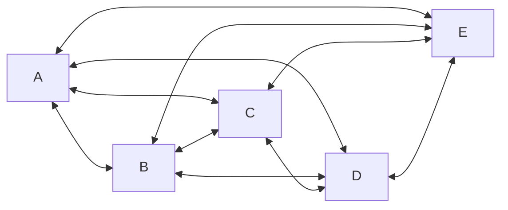
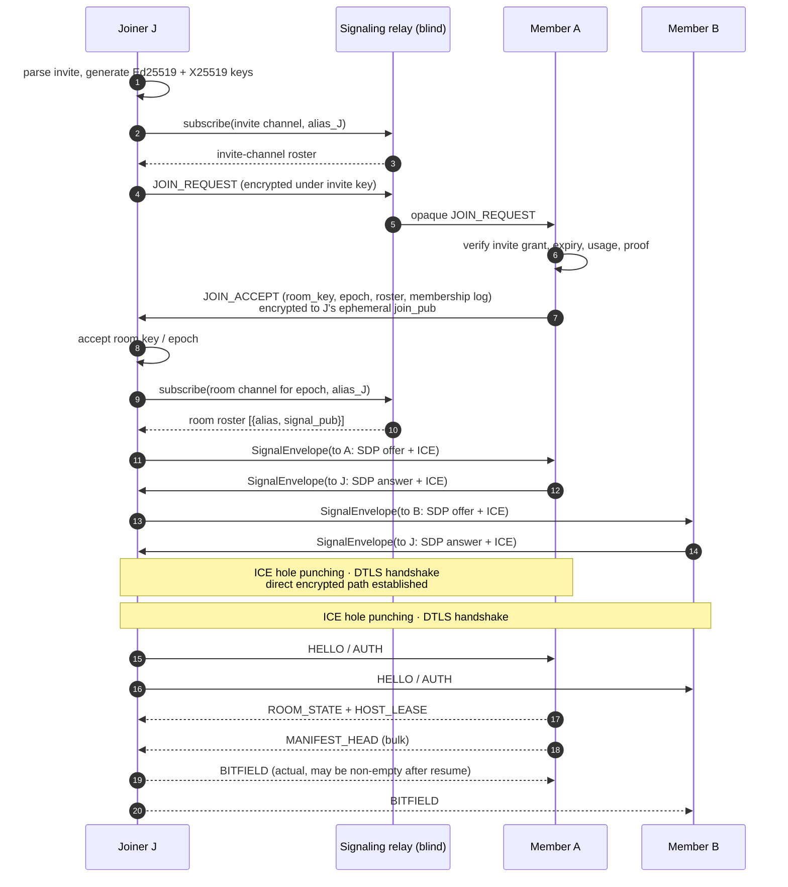

# Connectivity — How Peers Find and Reach Each Other

This document explains, from zero prior knowledge, how two computers on the
internet manage to talk directly to each other, and why PeerWatch does it
the way it does. It covers: the NAT problem, WebRTC's four building blocks
(SDP, ICE, STUN/TURN, DTLS/SCTP), the signaling relay, the full-mesh
topology, and the exact join sequence.

The normative relay and signal-envelope formats are in
[protocol.md](../spec/protocol.md) §11. This document is the
explanatory layer.

---

## 1. The problem: NAT

Almost every device sits behind a **NAT** (your home router does NAT). NAT
lets your device make *outbound* connections: your router rewrites your
private address (`192.168.x.y`) into its public one and remembers the mapping
so replies come back to you. But an *unsolicited inbound* packet has no
mapping and is dropped.

Consequence: two peers behind NATs **cannot simply connect to each other**.
This is why the Go v1 of PeerWatch (raw TCP) only worked on LANs or with
manual port forwarding. A truly P2P internet application must solve NAT
traversal. The industry-standard, browser-built-in solution is **WebRTC**.

> Why WebRTC and not something simpler? Because browsers *only* ship WebRTC
> for direct P2P. There is no “open a UDP socket” API in a web page.
> WebTransport is client–server over HTTP/3 and needs a relay, so it is not
> a replacement for peer-to-peer WebRTC. WebRTC is the common denominator,
> so native peers speak it too, via `webrtc-rs`.

---

## 2. WebRTC's four building blocks

### 2.1 SDP — “here is how to reach me”

Before two peers can connect, each must generate an **SDP (Session
Description Protocol)** blob: a text document describing itself: “I support
DataChannels, here are my crypto fingerprints, here are the network
addresses where I might be reachable.” One side produces an **offer**, the
other an **answer**. WebRTC does not specify *how* these blobs travel. That
exchange (called **signaling**, §3) is up to the application.

### 2.2 ICE candidates — “here are all my possible addresses”

A peer typically doesn't know its own public address. So it gathers a list
of **ICE candidates**, each a `ip:port` where it *might* be reachable:

- **host candidate** — its LAN address (works on the same network),
- **server-reflexive candidate** — its public NAT-mapped address, learned by
  asking a **STUN server** (§2.3),
- **relayed candidate** — an address on a **TURN relay** (§2.4), the last
  resort.

Both peers exchange candidates (this also happens over the signaling
channel) and then **try all pairs simultaneously**. The trick that defeats
NAT is **UDP hole punching**: if peer A sends a UDP packet to peer B's public
address *at the same time* B sends one to A's, each NAT sees its own device
making an “outbound” packet and opens a pinhole for the reply. Both packets
get through, and the peers now have a working direct path: no port
forwarding, no router config.

ICE tries pairs in priority order and picks the first that works
(host > server-reflexive > relayed, subject to local/remote priority rules).

### 2.3 STUN — “what is my public address?”

A **STUN server** is a nearly trivial UDP service: you ping it, it replies
“the packet came from `203.0.113.7:51234`”. That answer *is* your
server-reflexive candidate. STUN is stateless, sees nothing but UDP pings,
and is cheap to run. Public instances exist (e.g. Google's). Self-hosting
`coturn` gives you STUN in a two-line config. PeerWatch treats the STUN
server list as ordinary configuration with sane public defaults.

### 2.4 TURN — the relay of last resort

For roughly 10–15 % of peer pairs (symmetric NATs, some corporate
firewalls), hole punching fails. The fallback is a **TURN server**, which
relays the traffic. Even relayed traffic stays encrypted: TURN forwards
DTLS/SCTP ciphertext it cannot read.

**PeerWatch v1 ships TURN as optional configuration, but TURN is part of
M1, not a late hardening item.** Without a configured TURN server, unlucky
pairs fail with a clear error message (“direct connection to peer X
impossible. Consider configuring TURN”). We do not silently relay through
strangers' infrastructure.

TURN credentials should be short-lived and provisioned by the operator
(e.g. `coturn` `use-auth-secret` with a time-limited username), not a static
password checked into a client build.

### 2.5 DTLS + SCTP — security and messaging on top

Once ICE finds a working path, WebRTC automatically layers on:

1. **DTLS handshake**: TLS adapted to datagrams. Both sides present
   self-signed certificates whose fingerprints were pinned inside the
   authenticated SDP exchange, so the handshake is mutually authenticated
   and everything after it is encrypted. Transport encryption is free.
2. **SCTP association** — a message-oriented transport (unlike TCP's byte
   stream) with configurable reliability/ordering per channel.
3. **DataChannels** — named logical channels over SCTP. One message sent =
   one message delivered.

PeerWatch opens **three DataChannels per peer connection**:

| Channel | Ordering | Carries |
|---------|----------|---------|
| `control` | reliable, ordered | handshake, room state, manifest head, bitfields, votes, chat, sync, pings |
| `bulk` | reliable, ordered | manifest chunks and appends |
| `data` | reliable, **unordered** | block requests, block payloads, cancels |

The `data` channel is deliberately unordered: a lost block message only
needs its own retransmission, not head-of-line blocking of the blocks
queued behind it. The `bulk` channel keeps a large manifest from blocking
`SYNC`/votes on `control`.

---

## 3. Signaling: the one thing WebRTC can't do

WebRTC deliberately omits any mechanism for the initial exchange of SDP and
ICE candidates. That bootstrap (called **signaling**) requires *some*
pre-existing channel between the peers.

PeerWatch uses a **tiny signaling relay**: a self-hostable WebSocket
mailbox (`pw-signal-relay`). Its entire job:

1. Let peers subscribe to a **channel** (a room mailbox) by name.
2. Forward opaque, per-peer-encrypted envelopes between aliases in that
   channel.
3. Notify channel members of joins and leaves.

### 3.1 What the relay sees — and what it doesn't

The relay is a blind mailbox, but “blind” has a precise meaning. An alias is

```
alias = HMAC-SHA256(room_psk, "pw-alias-v2" || peer_id || epoch)[0..16]
```

with `room_psk = HKDF-SHA256(room_key, salt=room_id||epoch,
info="pw-room-psk-v2")` ([protocol.md](../spec/protocol.md) §3, §4.3). The relay
sees:

| Visible | Not visible |
|---|---|
| Opaque `channel_hash` values (32 B) | `room_id` (encrypted inside `SignalEnvelope`) |
| Per-epoch aliases (16 B) | Stable peer IDs |
| Epoch integers | Static identity keys (`enc_pubkey`) |
| Epoch-scoped `signal_pub` | Room key |
| Envelope sizes, timing | Plaintext SDP, ICE candidates, media, chat, votes |
| WebSocket source IPs | |

What that means in practice:

- **No cross-room linkage.** Aliases are `HMAC(room_psk, …)`, so the same
  peer in two rooms produces unrelated aliases.
- **No cross-epoch linkage.** `room_psk` and the channel both change per
  epoch, so an alias in epoch 3 says nothing about epoch 4.
- **Room linkage *within* an epoch is possible**, and so is room linkage
  *across* epochs via `epoch` and the lobby channel (§3.5). The relay can
  tell that *a* room continued; it cannot tell *which* room, or which
  people are in it.
- **IP observation is unavoidable.** IP addresses are personal data;
  self-hosting reduces exposure but does not eliminate it.
- It can **deny service** or **eclipse** a peer by dropping signaling. It
  cannot read, join, or impersonate a peer.

An earlier revision put `room: bytes .size 16` in the cleartext
`SignalEnvelope` header, which handed the relay the room identity directly
and defeated the epoch-scoping argument above. `room_id` now lives inside
the encrypted plaintext; the header uses `channel_hash` as its HKDF salt,
which the relay already knows, so nothing new is exposed.

### 3.2 Signaling encryption

Signaling is encrypted **per peer**, not under a room-wide static key:

```
SignalEnvelope {
  v, epoch, from_alias, to_alias, seq,
  eph_pub, nonce, ciphertext, sig
}

plaintext = { from_pubkey, room_id, payload }
```

- The sender generates an ephemeral X25519 key and derives a shared secret
  with the recipient’s **authenticated** epoch-scoped `signal_pub`.
- The payload (SDP/ICE/join data) is encrypted with XChaCha20-Poly1305;
  the header is authenticated as AAD.
- The sender signs the header + ciphertext with Ed25519. The relay cannot
  forge or modify an envelope, and other room members cannot decrypt it.
- Invite bootstrap uses the invite key for the first `JOIN_REQUEST`, then the
  invitee’s ephemeral `join_pub` key for `JOIN_ACCEPT`.

**Where `signal_pub` comes from matters.** The relay’s `RelayRoster` is a
discovery *hint*: it tells you which aliases are currently subscribed. The
key used for encryption comes from the **host-signed `ROOM_STATE` roster**
([protocol.md](../spec/protocol.md) §7.2), which binds `peer_id → signal_pub`
under the Host’s signature. If you take `signal_pub` from the relay, a
malicious relay substitutes its own key, decrypts your SDP, learns the DTLS
fingerprints and ICE candidates, and re-encrypts to the real recipient. It
still cannot *impersonate* anyone — AUTH binds the fingerprints and public
keys, so the splice fails at AUTH — but it can read your network topology
and metadata, which is exactly what the encryption was for.

The rule: **no authenticated `signal_pub`, no `SignalEnvelope`.** A peer
that has not yet received a roster entry for a recipient waits for
`ROOM_STATE`, or falls back to manual signaling (§3.4), rather than
trusting the relay.

### 3.3 Why not fully serverless signaling?

The alternative is manual copy-paste: each joiner would paste an offer token
to an existing member and paste an answer token back (two out-of-band
exchanges per join, ~2 KB blobs). It works, and the signal envelope format
is transport-agnostic so a manual fallback can be added, but for rooms of
3+ people the UX is poor. The relay is the default. It is self-hostable in
one command and holds no persistent data.

### 3.4 Relay limits

A production relay is more than a 200-line demo. It must enforce:

- max channels and peers per channel;
- max `SignalEnvelope`/`InviteEnvelope` size (32 KiB) and signaling bytes/s per alias;
- max `LOBBY_BASIS` body (1 KiB) and retained lobby records (512/channel,
  24 h);
- idle timeout (90 s) and WebSocket ping/pong (30 s);
- per-IP connection and channel quotas;
- structured error codes ([errors.md](../spec/errors.md)) and metrics
  ([observability.md](../guide/observability.md)).

The relay keeps no state on disk. A room’s mailboxes vanish when its last
member disconnects and `lobby_retention` elapses.

### 3.5 The lobby channel: surviving a rekey while offline

A room has **two** relay channels, and every member subscribes to both:

| Channel | Derivation | Lifetime | Carries |
|---|---|---|---|
| epoch channel | `BLAKE3("pw-channel-v2" \|\| room_id \|\| epoch)` | one epoch | `SignalEnvelope` (SDP/ICE) |
| lobby channel | `BLAKE3("pw-lobby-v2" \|\| room_id)` | whole room | `LOBBY_BASIS` only |

Why a second channel exists: when the room rekeys ([protocol.md](../spec/protocol.md)
§4.4), the epoch channel changes. A member that was offline during the
rekey does not know the new channel and cannot derive it without the new
`epoch` — a chicken-and-egg problem that, in an earlier revision, made
any disconnected member permanently unrecoverable.

The lobby breaks the cycle. Because epoch keys are *derived* rather than
chosen (§4.4.1), a member that holds epoch `e` only needs to learn
`rekey_basis_hash` to compute `room_key(e+1)`. `LOBBY_BASIS` carries exactly
that:

```
LOBBY_BASIS = {
  room_id, epoch,
  basis_hash, basis_kind: KICK | ROTATE,
  publisher_pubkey, signature,
}
```

A rejoining peer reads the lobby, replays any missed bases in order,
derives the current key, and joins the current epoch channel. It never
needs to have been online at the moment of the kick.

The lobby is public (derived from `room_id` alone), which has two
consequences that must be stated rather than implied:

- A kicked peer can read the lobby too. That is acceptable **only because
  key secrecy is not the barrier that excludes it** — the banlist and AUTH
  are. See [protocol.md](../spec/protocol.md) §4.4.3 for the full argument
  and [security.md](security.md) §6 for the residual risk.
- Anyone who learns `room_id` can read lobby metadata (that a room exists,
  its current epoch, and when it last rekeyed). `room_id` is only shared
  with invitees, so this is the same exposure class as the invite itself.

---

## 4. Topology: full mesh



Every peer holds **one RTCPeerConnection to every other peer**:
`N·(N−1)/2` total connections for N peers (10 peers → 45 total, 9 per
client). A WebRTC connection is heavier than a TCP socket (each carries an
ICE/DTLS/SCTP stack), but ~15 connections per client is comfortable on
desktop browsers and native processes. **Target room size for v1: 5–16
peers.**

The protocol does not *assume* full connectivity (bitfields, requests, and
gossip work over any connected graph), but **partial-mesh gossip is not
specified in v1**. Full mesh is the best latency and simplicity at
watch-party scale. See [roadmap.md](../roadmap.md).

---

## 5. The join sequence, step by step



Points of note:

- The **joiner initiates** an offer to every existing peer. Answers come
  back through the relay. ICE candidates may trickle both ways for a few
  seconds after the initial exchange.
- The invite is **consumed**: `JOIN_ACCEPT` includes a membership record and
  the current room epoch. The invite cannot be reused after `max_uses`.
- The relay’s only state is: channel → set of aliases. Rooms whose last
  member disconnects vanish from the relay’s memory.
- Late joiners while a video is playing receive the host lease, manifest
  head, the manifest chunks they need, and the current playback position;
  they buffer a few segments and land in sync via the drift controller
  ([sync.md](sync.md)).
- Peers stay connected to the relay (cheap: a ping every 30 s) so late
  joiners can be admitted and dropped connections re-established.

---

## 6. Disconnects and reconnects

- **Clean exit**: a peer sends `BYE` on its control channels, then closes.
  Peers remove it from the roster immediately.
- **Unclean exit** (crash, network drop): WebRTC's connectivity checks
  detect the dead path (consent freshness timeouts, typically 5–15 s). The
  peer is removed from the roster and from the scheduler's candidate set.
- **Reconnect**: the same install has the same Ed25519 key → same peer ID.
  A reconnect uses a new `SignalEnvelope` exchange (`ICE restart` or a fresh
  offer/answer) through the relay. The room recognizes the returning peer;
  its persisted bitfield means it keeps pieces it already had
  ([storage.md](storage.md)). Reconnect messages are specified in
  [protocol.md](../spec/protocol.md) §11.
- **Host rejoin**: if no takeover happened and the Host’s lease is still
  current, it may resume only after obtaining a majority
  `TAKEOVER_ACK`-style confirmation for a new term. Otherwise it rejoins as
  a normal complete seeder. There is never a second clock authority
  ([sync.md](sync.md) §6).
- **Relay flaps**: if the relay connection drops but the mesh is intact,
  the room keeps working indefinitely. The relay is only needed for *new*
  joins and reconnect signaling. Clients retry with backoff and surface
  “relay unreachable: new peers cannot join right now” in the UI.

---

## 7. Failure modes and what the user sees

| Situation | Detection | Behavior |
|-----------|-----------|----------|
| STUN unreachable | ICE gathering yields host candidates only | Same-LAN peers still connect, remote peers get a clear warning |
| Pair behind symmetric NATs, no TURN | ICE checks all fail (~5–10 s) | “Cannot establish a direct link to `pw:…`. Configure a TURN server or try a different network.” |
| Relay down at join time | WS connect failure | Join fails fast with relay address shown, retry/backoff |
| Relay down mid-room | WS ping timeout | Room continues, warning “new peers cannot join” |
| Single peer connection dies mid-room | ICE consent timeout | Roster shrinks; if it was the Host → host-leave procedure ([sync.md](sync.md) §6) |
| Invite expired/used | `JOIN_ACCEPT` rejected | “This invite is no longer valid; ask a member for a new one.” |
| Kicked peer tries old epoch | AUTH/channel mismatch | Rejected; it no longer has the current room key or channel |

---

## 8. Sizing notes

Per-connection costs that bound room size:

- DTLS-SCTP stack: tens of KB of state, ~1 timer wheel each, negligible at
  16 peers.
- Control traffic: bitfield broadcast every 1 s, Roaring-compressed
  ([roaring-compression.md](../spec/roaring-compression.md)); ~0.3–0.5 KB/peer, a
  few KB/s room-wide at 16 peers (was ~24 KB/s raw). Trivial.
- Data traffic: each peer downloads the stream once (≈ video bitrate) and
  uploads at a rate the scheduler caps by policy and by measured uplink
  (default target ≈ 1.5× video bitrate, but never more than the link can
  sustain). Details in [performance.md](performance.md).
- The Host’s uplink is the early bottleneck. Rarest-first fan-out turns
  each replicated piece into a new source, which is why backfill is not
  optional.
