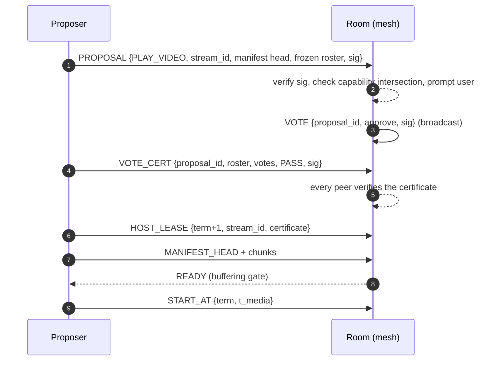

# Governance — Proposals, Votes, Host Leases, Kicks

A PeerWatch room has **no privileged roles**. The room creator gets nothing
after genesis. The Host gets exactly two duties (seed authority, clock
authority) for a specific `(stream_id, term)` and no powers over people.
Every collective decision (what to watch, who stays) is made the same way:
**signed proposals, signed votes, and certificates that every peer verifies
independently.**

The normative object layouts and signature preimages are in
[protocol.md](../spec/protocol.md) §5. This document explains the
rules and the edge cases.

---

## 1. Objects

```
Proposal = {
  proposal_id,                    // BLAKE3 of canonical body
  body: {
    kind: PLAY_VIDEO | KICK,
    payload,
    roster_snapshot,              // frozen at proposal time
    opens_at_ms, closes_at_ms,    // advisory UI window
  },
  proposer_pubkey,
  signature,
}

Vote = {
  proposal_id,
  approve: bool,
  voter_pubkey,
  created_at_ms,
  signature,
}

VoteCertificate = {
  proposal_id,
  roster_snapshot,
  votes: [Vote],
  result: PASS | FAIL,
  leader_pubkey,
  signature,
}
```

- `PLAY_VIDEO` payload: `stream_id`, the manifest head, pipeline info
  (remux / transcode-ahead / transmux, so voters know if quality is lossy),
  and the proposer’s capability flags.
- `KICK` payload: target pubkey + free-text reason.
- `proposal_id` is the hash of the canonical body, including the frozen
  roster. Two different roster snapshots are two different proposals.

### 1.1 Why a frozen roster

A threshold of “strict majority of the peers connected at tally time” is not
deterministic: a peer that sees 5 peers and a peer that sees 3 compute
different thresholds for the same votes, and honest peers produce conflicting
outcomes from identical inputs. Freezing the roster in the proposal makes the
threshold identical everywhere ([design-log.md](design-log.md) D23).

### 1.2 Why a certificate, not independent tallies

Every peer still verifies every signature. But they verify the **same
certificate**, not their own race against a wall clock. The certificate is
the authoritative vote set:

- every vote signature is valid;
- every voter is in `roster_snapshot`;
- no voter appears twice (conflicting votes: lower `vote_id` wins);
- `PASS` iff `approvals > |roster_snapshot| / 2`;
- the leader signature is valid.

Timestamps are advisory for UI and expiry. Consensus does not depend on
peers agreeing on a wall-clock cutoff. A peer that sent a vote and does not
see it in a certificate may reject that certificate and gossip its vote;
any peer may assemble an alternative certificate. If multiple valid
certificates exist for one proposal, prefer the one with the most valid
votes; tie-break by the lexicographically smallest certificate hash. Peers
gossip certificates until they converge.

The consequence is that honest peers can no longer disagree: they check the
same certificate rather than racing their own tally. A certificate that omits
a peer's vote is a governance dispute, not evidence of forgery.

---

## 2. Rules

1. **Eligibility**: every peer in the frozen roster may vote once per
   proposal. One key = one vote. Votes are non-transferable and
   non-changeable.
2. **Threshold**: `approvals > |roster_snapshot| / 2` — a strict majority
   of the frozen roster. A two-person room therefore requires unanimity.
3. **Expiry**: a proposal that does not gather a certificate by
   `closes_at_ms` is marked expired in the UI, and the room stops prompting.
   A majority certificate is still cryptographically valid; peers SHOULD
   accept it unless the room has already moved to a higher term, because
   rejecting it based on arrival time would make governance depend on the
   network. The certificate-selection rule in §1.2 decides between competing
   valid certificates.
4. **Determinism**: every peer verifies the certificate’s signatures,
   roster, and majority. Identical certificates → identical outcome. There
   is no “vote server” to disagree about.
5. **Rate limit**: one active proposal per peer. Proposal spam → strikes.

---

## 3. PLAY_VIDEO: host transition protocol



On passage:

1. **Role handoff**: the proposer becomes **Host-elect**. The previous Host
   is demoted to ordinary seeder. It keeps its store, so old-stream pieces
   may still be served to stragglers, but the room’s attention moves on.
   The previous Host’s `term` is now stale; peers ignore its
   `SYNC`/`MANIFEST_*`.
2. **Lease**: the Host-elect publishes a `HOST_LEASE` with `term+1`,
   `stream_id`, `prev_lease_hash`, and the `VoteCertificate`. Peers verify
   the certificate and the term before accepting the new authority.
3. **Manifest distribution**: the Host sends `MANIFEST_HEAD` and the
   manifest chunks to peers missing them. For live-transcode proposals the
   manifest is append-only ([media-pipeline.md](media-pipeline.md) §5).
4. **Buffering gate**: the Host begins serving immediately; peers’
   schedulers fill URGENT/WINDOW. When every connected peer reports
   `READY` (init segment + ≥ 2 segments buffered) **or** 20 s elapse
   (whichever first), the Host broadcasts:
   ```
   START_AT { stream_id, term, seq, t_media_ms: 0 }
   ```
   Everyone starts decode aligned on that timestamp; the PI controller
   ([sync.md](sync.md)) absorbs the residual milliseconds.
5. **From then on**: the new Host’s transport is the room’s clock for that
   term, the old stream’s data plane winds down (peers may keep seeding it
   to complete peers who want the file).

**Proposer obligation**: proposing is a commitment to stay. A peer whose
proposal passes and then immediately leaves triggers the standard host-leave
path ([sync.md](sync.md) §6), which, if nobody has pieces yet, means an
instant stall. UIs warn proposers accordingly.

### 3.1 Capability gate

Before a `PLAY_VIDEO` vote is presented, the proposer checks the
**intersection** of every connected peer’s `Caps.codecs`
([media-pipeline.md](media-pipeline.md) §2.1). If a peer cannot play the
proposed profile, the proposal must force FMP4/transcode or be rejected.
A room is the unit of compatibility.

---

## 4. KICK: removing a peer

On a `KICK` proposal passing:

1. The target’s **public key** is added to the room **banlist** with the
   `VoteCertificate` as proof. A bare `KICK_NOTICE` without a certificate is
   ignored.
2. Every peer: tears down its connection to the target, ignores its further
   messages, refuses future AUTH carrying that key, and **rotates the room
   key** to `epoch+1` ([identity.md](identity.md) §3.3). The relay channel
   changes, so the kicked peer cannot subscribe to the new epoch.
3. The kicked peer may still know the old room key, but it cannot
   authenticate or find the new channel. A fresh key requires a fresh invite
   from a member, which the room can refuse.
4. **Re-entry**: with the same key, impossible (banlist + old epoch). With a
   *fresh* key and a fresh invite, technically possible; it is visibly a new
   identity, and repeat offenders are re-kicked at trivial cost. Sybil
   discussion: [security.md](security.md) §6.

Kicks are the *social* tool. **Cryptographic misbehavior needs no vote**:
a bad block proof, a signature failure, or a protocol violation triggers
*immediate local bans* by any witness ([security.md](security.md) §4).
Signed `BAN_REPORT`s are advisory evidence and never auto-ban without local
proof. Votes are for judgment calls; math handles the rest.

### 4.1 Banlist propagation

- The current Host includes the banlist in `ROOM_STATE`; each entry carries
  its `KickCertificate`.
- A late joiner may receive the banlist from any peer, but it verifies every
  certificate. An entry without a valid certificate is ignored.
- Banlists are persisted per `room_id` and survive room idle periods.

#### 4.1.1 Omission is detectable, not just "an attack"

`ROOM_STATE` must fit one envelope ([protocol.md](../spec/protocol.md) §9), so a
large banlist cannot always travel with full certificates. The state
carries an explicit completeness flag:

```
ROOM_STATE = {
  state_version, term, host_lease, roster,
  banlist: [BanEntrySummary],     // peer_id + certificate_hash only
  banlist_complete: bool,         // are the full certificates included?
  banlist_root: Hash32,           // BLAKE3 over sorted certificate hashes
  active_proposals, current_stream,
}
```

This turns omission from a hand-wave into a checkable property:

1. Every peer recomputes `banlist_root` from its own verified set and MUST
   reject a `ROOM_STATE` whose `banlist_root` differs from the entries it
   can see in that same message.
2. `banlist_complete: false` obliges the receiver to fetch the missing
   `BanEntry` certificates from **at least two distinct peers**, and to
   compare the resulting `banlist_root` values. Divergent roots mean
   someone is withholding.
3. A peer that receives `banlist_complete: true` and later receives a
   `KICK_NOTICE` whose certificate is older than that `state_version` has
   **proof** that the author of that `ROOM_STATE` withheld a ban. The
   evidence is objective (two signed messages that contradict), so it is a
   `BAN_REPORT` with real teeth rather than a rumor.
4. A joiner MUST NOT enforce a ban entry it has not verified itself, and
   MUST NOT connect to a peer it has a verified ban for — even if the Host
   omits it. Local verification is the authority; `ROOM_STATE` is a
   convenience.

The Host is therefore not trusted to be complete, only to be consistent.
A Host that omits a ban is detectable by any peer that has the certificate,
and a Host that lies in `banlist_root` is caught immediately by rule 1.

---

## 5. Edge cases and their resolutions

| Case | Resolution |
|------|-----------|
| Concurrent PLAY_VIDEO proposals | Both may gather votes. If both pass, they both claim `term+1`; prefer the certificate with the most valid votes, then the lowest certificate hash. The other lease is invalid. |
| Proposal passes while a KICK of the proposer is running | Independent certificates. If both pass, the kick executes; the new Host is removed → host-leave path. |
| Proposer leaves mid-vote | Another peer may assemble a certificate from the votes it has. If no majority certificate exists, the proposal expires. |
| Host loses connectivity but room is split (partition) | Only a component with a strict majority of the frozen roster can pass a certificate or elect a new host. The minority stalls at its frontier. On heal, the higher valid term wins; invalid/conflicting certificates do not. |
| Exactly-2-person room, 1–1 vote | Strict majority of 2 = 2 → proposals require unanimity. Documented, intended. |
| Griefing via repeated proposals | One active proposal per peer; proposal spam → protocol-violation strikes. |
| Kicked peer rejoins with a new key | It needs a fresh invite; the room can refuse. If admitted, it is a new peer ID with no history. |
| Two valid certificates for the same proposal | Choose the one with the most valid votes; tie-break by lowest certificate hash. Gossip until convergence. |
| A certificate omits a peer’s vote | The peer rejects it and re-broadcasts its vote; any peer may assemble an alternative. If the room cannot converge, the proposal is contested and no state change should be applied. |
| Host’s `SYNC` has a valid signature but wrong term | Authority violation; ignore and strike. Do not treat it as forgery. |

---

## 6. What governance deliberately does not do

- **No moderators, no veto, no creator powers.** If a group wants an
  iron-fisted host, they can simply… not pass votes they dislike.
- **No content arbitration.** Peers vote on *whether* to watch, not on
  whether a file is “allowed”. (A malicious *file* is a different threat;
  see the media-parser discussion in [security.md](security.md) §5.)
- **No persistent reputation across rooms.** Reputation is per-room
  ([security.md](security.md) peer scoring); cross-room identity reputation
  is a possible extension, deliberately out of v1 scope.
- **No general Byzantine consensus.** A coalition that controls a majority
  of the frozen roster can decide anything. That is the governance model;
  the docs do not pretend otherwise.
- **No secret ballots.** Votes are broadcast and signed; everyone can see
  who voted for what. This is a social design choice, not an anonymity
  feature.
