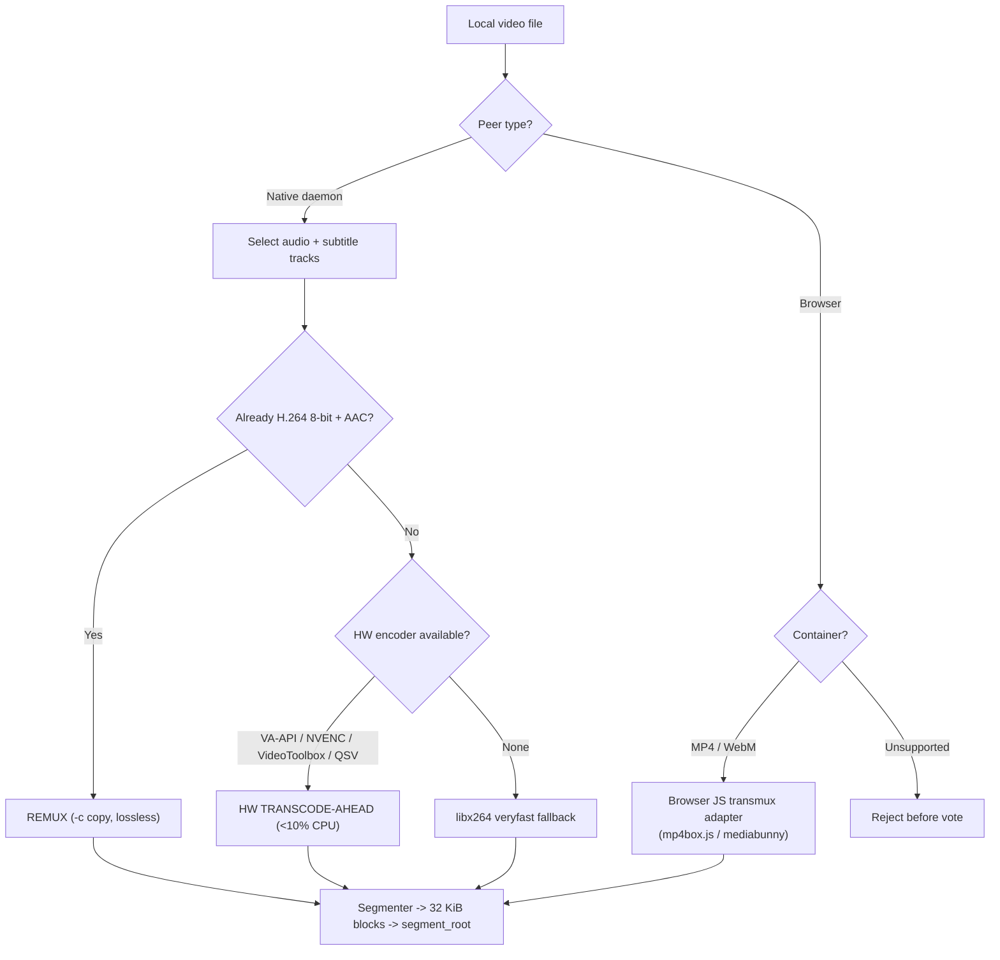

# Media Pipeline — Remux, Hardware Transcode-Ahead, Subtitles

PeerWatch shares one canonical segmented stream that plays identically in
browser MSE and native `mpv`. Normative manifest structures and parser limits
live in [protocol.md](../spec/protocol.md) §6 and §9.1.

---

## 1. Canonical wire format

| Profile | Container | Video | Audio | When used |
|---|---|---|---|---|
| `FMP4` (default) | fragmented MP4 | H.264 (AVC) | AAC-LC | Default for all native proposals and MP4 browser sources |
| `WEBM` (secondary) | WebM (EBML clusters) | VP9 | Opus | Browser-proposed `.webm` only when every peer declares `WEBM` + `VP9` + `OPUS` in `Caps` |

Every stream consists of:

- **Segment `0` (Init)**: `ftyp` + `moov` (or WebM EBML header + Tracks).
- **Segments `1..=N` (Media)**: keyframe-aligned `moof` + `mdat` fragments (or
  keyframe-aligned EBML clusters), targeting **≈ 4 s** per segment.
- **Subtitles (optional, v1)**: up to 16 WebVTT sidecar tracks extracted at
  proposal time (typically 50–150 KiB each), hash-verified and delivered on
  `bulk` for native HTML5 `<track>` and `mpv` rendering.

---

## 2. Dynamic codec compatibility

Rather than forcing peers to list every H.264 profile/level string up front:

1. `HELLO` exchanges structured `Caps` (`containers`, `video_codecs`,
   `audio_codecs`, `max_h264_level`) so a proposer knows immediately whether
   remux or transcode is appropriate.
2. When `PROPOSAL(PLAY_VIDEO)` or `QUEUE_ADD` carries the exact emitted MIME
   string (`StreamParams.mime`, e.g. `video/mp4; codecs="avc1.640028,mp4a.40.2"`),
   each peer tests it live (`MediaSource.isTypeSupported(mime)` for MSE, or
   decoder check for `mpv`) and reports `PROPOSAL_COMPAT { playable }` if
   incompatible.
3. If any peer cannot decode a remuxed profile (e.g. H.264 High 10-bit), the
   proposer can fall back to `TRANSCODE_AHEAD` targeting standard 8-bit
   H.264 High@L4.1 + AAC-LC.

---

## 3. Source pipelines



### 3.1 Remux (lossless fast path)

When the selected video/audio streams are already browser-compatible H.264 +
AAC:

```sh
ffmpeg -i in.mkv -map 0:v:0 -map 0:a:<selected> -c copy \
  -movflags +frag_keyframe+empty_moov+default_base_moof -f mp4 pipe:1
```

Remux preserves source keyframes (if the source GOP is longer than 4 s, actual
segments follow the source keyframes; `target_segment_ms` is advisory).

### 3.2 Hardware-accelerated live transcode-ahead

When transcoding is required (HEVC, AV1, 10-bit H.264, AC3/DTS audio):

1. `pw-node` probes hardware encoders in priority order:
   - Linux: `h264_vaapi`, `h264_nvenc`, `h264_qsv`
   - macOS: `h264_videotoolbox`
   - Windows: `h264_nvenc`, `h264_qsv`, `h264_amf`
   - Fallback: `libx264 -preset veryfast -crf 23`
2. Keyframes are forced by timestamp (VFR-safe):
   `-force_key_frames "expr:gte(t,n_forced*4)"` with `-maxrate` / `-bufsize`
   capping bitrate spikes.
3. Playback starts after a ~12–15 s head start; pipe reading throttles when
   `encoded_ms - playhead_ms > 120 s`. `stderr` is continuously drained into a
   64 KiB ring buffer so ffmpeg can never deadlock.
4. **Seekable live transcode**: if the Host seeks past the currently encoded
   frontier (e.g., jumping from `05:00` to `45:00`), `pw-core` emits
   `MediaCommand::SeekSource { target_ms }`. `pw-node` restarts ffmpeg with
   `-ss <target_ms>` (using `-output_ts_offset` so `tfdt` timestamps stay
   aligned) and publishes the new segments via `MANIFEST_APPEND` immediately —
   no 10-minute sequential catch-up wait.

### 3.3 Subtitle extraction

Selected text subtitle tracks (SRT, ASS/SSA, WebVTT) are extracted once at
proposal time with `ffmpeg -i in.mkv -map 0:s:<idx> -f webvtt pipe:1` (takes
< 1 s), hashed, and attached to `ManifestHead.subtitles`. Image-based subtitles
(PGS/VobSub) are flagged as unsupported in v1.

### 3.4 Browser sources

Browser peers delegate MP4 re-fragmentation and WebM cluster slicing to a
proven JS library (`mp4box.js` / `mediabunny`) behind the browser shell adapter
rather than reimplementing a custom Rust/WASM muxer in v1. `pw-core` receives
identical `Event::MediaSegment` buffers regardless of source pipeline.

---

## 4. Segmenter & security hygiene

1. Parse fMP4 boxes (`ftyp`/`moov` → segment `0`; each `moof`+`mdat` → segment
   `s`, reading `tfdt` for `t_start_ms`), enforcing every pre-allocation bound
   in [protocol.md](../spec/protocol.md) §9.1.
2. Slice each segment's exact byte range `[0..byte_len]` into 32 KiB blocks,
   hash every block (`pw-block-v3`), compute `segment_root`, and immediately
   publish the segment to the manifest and RAM store — zero waiting for a
   subsequent segment to fill an unaligned piece boundary.
3. Always invoke `ffmpeg`/`ffprobe` via argument vectors (never a shell) and
   treat all container metadata and `ffprobe` JSON as untrusted input.
