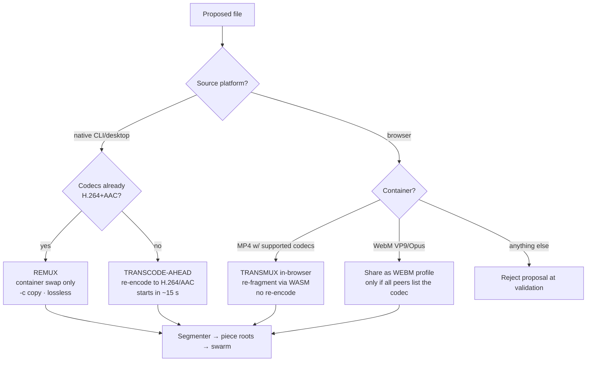

# Media Pipeline — From “Any Local File” to the Canonical Stream

The Go version of PeerWatch shared the *original file bytes* and let mpv
deal with them. That worked because every peer was a desktop with mpv. It
cannot work in a browser: a web page cannot hand a half-downloaded MKV to a
`<video>` element. Browsers stream video through **MSE (Media Source
Extensions)**, and MSE demands a specific shape of data.

This document explains that shape, why it was chosen, and the three
pipelines that convert a proposed file into it: **remux**, **live
transcode-ahead**, and **in-browser transmux**. The normative manifest and
block formats are in [protocol.md](../spec/protocol.md) §6.

---

## 1. How a browser actually plays streamed video

A `<video src="movie.mp4">` element downloads progressively and can start
playing early, but only *from the beginning*, and seeking requires the
server to support byte ranges *and* the file to have a seekable index. That
model is useless for P2P, where data arrives out of order from many peers.

The real streaming API in browsers is **MSE**:

1. JavaScript creates a `MediaSource` and attaches it to a `<video>`.
2. It adds a `SourceBuffer` describing one stream's format, e.g.
   `video/mp4; codecs="avc1.640028,mp4a.40.2"` (H.264 video + AAC audio).
3. It then **appends bytes** to that buffer:
   - first an **initialization segment** — container headers + codec
     configuration (`ftyp` + `moov` boxes in MP4 terms),
   - then any sequence of **media segments**, each starting on a video
     **keyframe**, each self-contained enough to decode (`moof` + `mdat`).
4. The player decodes appended media continuously; JS manages the buffer
   (appending ahead of the playhead, evicting behind it).

This is how YouTube, Twitch, and every serious web player work. The key
facts for us: **segments are the unit of playback**, segments must start on
keyframes, and the app controls exactly which bytes arrive when — a perfect
match for a P2P chunk scheduler.

---

## 2. The canonical wire format

> **Everything the swarm shares is one of two stream profiles:**
>
> | Profile | Container | Video codec | Audio codec | When used |
> |---------|-----------|-------------|-------------|-----------|
> | `FMP4` (default) | fragmented MP4 | H.264 (AVC) | AAC | Anything a native peer proposes, the universal target |
> | `WEBM` | WebM (EBML clusters) | VP9 | Opus | Browser-proposed `.webm` files, only if **every** connected peer lists the WebM codec string in `Caps.codecs` |

**Why fragmented MP4 / H.264 / AAC as the default:**

- **MSE support is broad**: Chrome, Firefox, Safari, and WebKitGTK (the
  Tauri webview) decode H.264+AAC in fMP4 via MSE on most desktop installs.
  It is the combination that needs the least per-browser negotiation, not
  “universal” by magic. WebKitGTK needs GStreamer plugins; Firefox on Linux
  may lack AAC. The desktop app has an mpv fallback for that reason.
- **mpv plays it natively**, so CLI and desktop-mpv-fallback consume the
  *identical bytes* the browser gets. One wire format, no dual distribution.
- **ffmpeg emits it trivially** (see §4).
- **Segments double as the seek index**: because every segment starts on a
  keyframe, seeking to time T = jump to the segment containing T and decode
  forward. No cross-segment dependencies.

A plain (“progressive”) MP4 file is **not** directly streamable via MSE: its
single `moov` box describes the whole file and its frames aren't grouped
into independently-decodable fragments. Converting MP4→fMP4 is a container
operation, not a re-encode (§3).

### 2.1 Room-wide codec compatibility

Before a `PLAY_VIDEO` proposal is voted on, the proposer checks the
**intersection** of every connected peer’s `Caps.codecs` (§2.1.1 of the
schema). A peer's set must contain `StreamParams.codecs` verbatim. If even one peer cannot play the proposed profile, the proposal
must either:

- choose `FMP4` and transcode/remux to it, or
- be rejected with a clear message.

Validating only the proposer's own browser can strand a Safari/WebKitGTK
peer on a WebM stream after the vote has passed. The room is the unit of
compatibility, not the proposer ([design-log.md](design-log.md) D8).

`ManifestHead.params.codecs` must be the actual codec string emitted by the
pipeline, not a hard-coded guess. `avc1.640028` is High 4.0; if x264 emits a
different profile/level, the string changes.

---

## 3. The three source pipelines

When a peer proposes a file, `pw-media` **probes** it (native: `ffprobe`,
browser: a lightweight demux pass) and selects a pipeline:



### 3.1 REMUX (the fast path)

If the file's codecs are already H.264 + AAC but the container isn't
fragmented (typical: `.mkv`, plain `.mp4`), we only change the *container*:

```
ffmpeg -i in.mkv -c copy \
       -movflags +frag_keyframe+empty_moov+default_base_moof \
       -f mp4 out.fmp4
```

`-c copy` passes encoded frames through untouched: **lossless and
I/O-bound**. A 10 GB file remuxes in tens of seconds on SSD; streaming
remux can start emitting segments immediately.

**Remux cannot create keyframes.** If the source has a 10 s GOP, `-c copy`
cannot produce 4 s segments. The pipeline must either accept larger
segments (and document worse seek granularity) or re-encode the file. The
manifest’s `target_segment_ms` is a target, not a guarantee.

### 3.2 TRANSCODE-AHEAD (the compatibility path)

If codecs are incompatible with the room profile (HEVC, AV1, VP9-in-MKV,
AC3, DTS, …), the file must be re-encoded to H.264/AAC. Doing this for a
whole movie before anyone watches would mean minutes of dead time, so
PeerWatch **transcodes while the room watches**:

1. `ffmpeg -i in.X -c:v libx264 -preset veryfast -crf 23 \
   -maxrate <cap> -bufsize <2×cap> -c:a aac -b:a 160k \
   -movflags +frag_keyframe+empty_moov+default_base_moof -f mp4 -`
   writes the fMP4 stream to a **pipe**.
2. The **segmenter** parses the stream into segments as they emerge,
   computes block hashes and piece roots, and feeds them to the store and
   manifest. The Host's bitfield grows in real time.
3. Playback begins after a **~15 s head start** (a few segments exist,
   enough for peers to buffer).
4. A **throttle** keeps the encoder ~60–120 s ahead of the room playhead
   (the segmenter stops reading the pipe, ffmpeg blocks on write, resume
   when the window advances). The reader must also drain stderr so ffmpeg
   cannot deadlock on a full error pipe.
5. The output is an **append-only** partial file. It is not pre-sized,
   because `total_size` is unknown until the transcode ends. It becomes a
   persistent cache if the cache policy keeps it; otherwise it is evicted
   like any other stream after the room ends.

Preset: **x264 `veryfast`** (decision log, [roadmap.md](../roadmap.md)), the
best speed/quality trade for live work: ~2–5× realtime for 1080p on a
modern 4–8-core CPU (30–70 % machine load while active). `-maxrate` /
`-bufsize` bound bitrate spikes so piece demand and host uplink stay
predictable. A higher-quality opt-in preset for powerful hosts is a planned
config knob.

Remux output and transcode output go through the *same* segmenter, so
downstream code doesn't care which path produced the stream.

### 3.3 TRANSMUX (browser-proposed files)

Browsers can't run full ffmpeg (ffmpeg.wasm exists but is too slow for
real-time). But a browser peer may only propose **mp4/webm**, and crucially:

- **MP4 with MSE-supported codecs** needs no re-encode, only
  *re-fragmentation*: parse the MP4 sample tables and repackage the samples
  into fMP4 segments. This “transmuxing” is pure container math and runs
  fine in WASM/JS (mp4box-style demux → our segmenter). Fast, lossless.
  If `moov` is at the end of the file, use `File.slice` range reads to read
  the tail; if that is impossible, reject with a clear message.
- **WebM (VP9/Opus)** can't cheaply become MP4 in-browser, but browsers
  that support it can play WebM via MSE
  (`video/webm; codecs="vp9,opus"`). So WebM is shared as the `WEBM`
  profile, segmented at **EBML cluster** boundaries. Clusters usually start
  on keyframes, but not by guarantee; the segmenter must validate this and
  reject a stream it cannot seek. Safari/WebKitGTK MSE support for WebM is
  not universal, so `WEBM` is allowed only when every peer advertises
  in every peer's `Caps.codecs`.
- **Anything else** (an MP4 wrapping HEVC, an AVI, …) fails validation:
  the prober checks `MediaSource.isTypeSupported` for the exact codec
  string, and the proposal is rejected before it reaches a vote.

Native peers receiving a `WEBM` stream are unaffected; mpv decodes VP9/Opus
natively.

### 3.4 Segment sizing

Segments target **4 seconds** of media (keyframe permitting, the encoder is
configured with a max GOP of 4 s so keyframes exist at least that often).
Trade-off: shorter segments = finer seek granularity and faster cold start,
but more overhead and larger segment tables — 4 s is the DASH/HLS default
sweet spot.

For variable-frame-rate sources, “4 s” must be enforced by timestamps, not
frame count. Use `-force_key_frames "expr:gte(t,n_forced*4)"` or equivalent;
`-g 120` is only correct at a fixed 30 fps.

### 3.5 Segment ↔ piece mapping

Pieces are fixed 512 KiB; segments are variable size and keyframe-aligned.
They are not aligned. A piece may contain the tail of one segment and the
head of the next. The manifest’s `SegmentEntry` records `piece_start`,
`piece_end`, `block_start`, and `block_end` (inclusive), so:

- a player waits until every piece overlapping a segment is complete;
- a seek prioritizes the pieces for the target segment;
- a peer serving a block does not need to know which segment it belongs to.

The coupling cost is that the last piece of segment N and the first piece of
segment N+1 may block each other. This is acceptable at 512 KiB pieces; do
not shrink pieces without re-checking cold-start and seek latency.

---

## 4. ffmpeg command reference

| Task | Command sketch |
|------|----------------|
| Probe | `ffprobe -v quiet -print_format json -show_format -show_streams in.X` |
| Remux | `ffmpeg -i in.X -c copy -movflags +frag_keyframe+empty_moov+default_base_moof -f mp4 pipe:1` |
| Transcode | `ffmpeg -i in.X -c:v libx264 -preset veryfast -crf 23 -maxrate 12M -bufsize 24M -c:a aac -b:a 160k -movflags +frag_keyframe+empty_moov+default_base_moof -f mp4 pipe:1` |
| GOP control | `-force_key_frames "expr:gte(t,n_forced*4)"` (timestamp-based, VFR-safe) |

The desktop app bundles or discovers system ffmpeg; the CLI requires
`ffmpeg` on `PATH` and fails with a clear install hint otherwise. Browser
peers never need ffmpeg.

Always invoke ffmpeg with an argument vector (`Command::new("ffmpeg").args`),
never through a shell. Treat ffprobe JSON as untrusted input.

---

## 5. What the segmenter actually does

The segmenter is the bridge between “ffmpeg output” and “the swarm's data
model” ([distribution.md](distribution.md)):

1. **Parse boxes**: read the fMP4 stream box-by-box. Emit box 0–N (`ftyp`,
   `moov`) as the **init segment**. Each `moof`+`mdat` pair is one **media
   segment**; timestamps are read from the `moof`'s `tfdt`.
2. **Index**: append `{t_start_ms, t_end_ms, piece_start, piece_end,
   block_start, block_end}` to the segment table. Times are integer
   milliseconds; ranges are inclusive.
3. **Slice**: cut segment bytes into 32 KiB blocks and group 16 blocks into
   a 512 KiB piece. Compute each block hash, build the piece Merkle root,
   and append the root to the manifest. The last piece/block may be short.
4. **Throttle**: pause reading when `last_segment_time − playhead > 120 s`
   (transcode path only).

Because the manifest's piece roots must exist *before* peers can verify
blocks, a live stream's manifest is **append-only**:

- The Host publishes `MANIFEST_HEAD` at proposal time (params, init segment,
  empty/partial roots).
- As segments are produced, the Host publishes `MANIFEST_APPEND` with new
  piece roots and segment entries.
- Peers apply appends in order. A peer that misses one requests the head
  and the missing chunks/deltas.
- `stream_id` is stable from proposal to final; `content_id` is assigned
  only by `MANIFEST_FINAL`.

A remuxed or transmuxed file is usually fast enough that its manifest is
complete before the vote ends, but the pipeline treats it as append-only
too. Do not assume a large remux is instantaneous.

---

## 6. Quality & policy notes

- **Remux is lossless, transcode is not.** x264 CRF 23 veryfast is visually
  transparent for most 1080p content, but it *is* a generation of loss. The
  proposal message states which pipeline will be used, so voters know. (An
  “original-quality download” side-channel is a possible extension, not
  v1.)
- **Native-only rooms MAY skip normalization.** If every peer advertises
  the same native profile and no browser peer is present, a room may share
  the original container directly; mpv handles anything. The manifest
  supports arbitrary profiles, this is a config option, off by default,
  because it silently breaks for any browser peer that joins later.
- **Subtitles**: out of scope for v1 (the pipeline passes only the first
  video + first audio stream). The manifest has a reserved field for
  subtitle tracks.
- **Native playback is an attack surface.** Browsers sandbox MSE decoding;
  native mpv/GStreamer does not. Run mpv with a restricted protocol
  whitelist, no network access where possible, and OS sandboxing
  (bubblewrap/firejail) if the platform supports it. See
  [security.md](security.md) §5 (malicious content / native playback).
