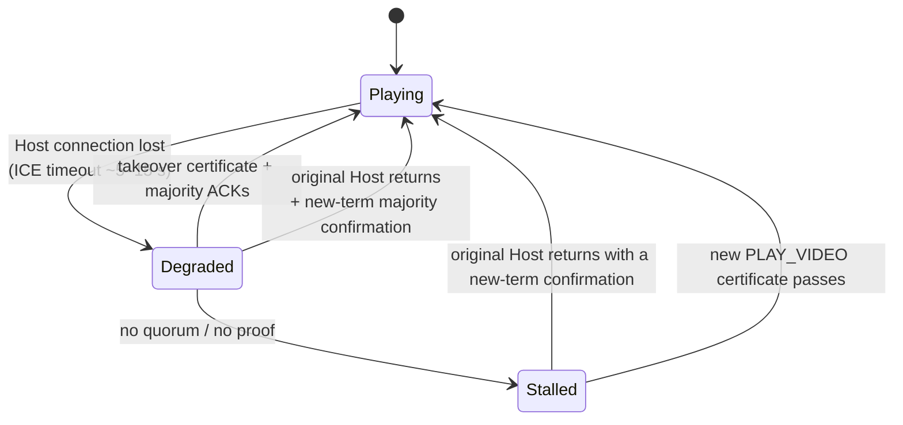

# Synchronization — Watching in Lockstep

A watch party is only a party if everyone sees the same frame at the same
moment. This document specifies the sync model: who owns the clock, how
followers track it (a PI feedback controller, with the math), the per-peer
**free-roam** escape hatch, and what happens when the Host vanishes mid-film.

The normative `SYNC`/`START_AT`/`TAKEOVER_*` payloads are in
[protocol.md](../spec/protocol.md) §5 and §7.5.

---

## 1. The model: the Host holds a lease on the clock

At any moment exactly one peer, the **Host**, is the **clock authority** for
a specific stream and term:

- Only the Host's play / pause / seek / rate actions propagate to the room.
- The Host broadcasts its transport state on the control channel:

```
SYNC { stream_id, term, seq, t_media_ms, state: PLAY | PAUSE, rate }
```

  …every **1 s** (heartbeat) **and immediately** on any transport event.
- Viewers' local transport controls do **not** affect anyone else. (A
  viewer's local pause/seek drops them into free-roam instead, see §5.)
- A `SYNC` is accepted only if the sender is the host named in the current
  `HostLease` and the message’s `term` matches. A valid signature from a
  non-host is an authority violation, not a clock update.
- `seq` increases monotonically per `(host, stream, term)`. A recorded old
  `SYNC` is rejected as stale; signatures alone do not stop replay.

Why a single authority and not, say, averaging? Because watch-party sync is
a *social* feature (“we're all at the same scene”), not a fairness problem:
one unambiguous reference is simple, converges instantly, and matches the
product rule that the file's owner runs the show. The lease/term machinery
makes “one authority” true even across host changes and partitions.

---

## 2. Estimating “host time” locally: RTT compensation

A `SYNC` saying “I'm at 45.2 s” arrives some milliseconds after it was true.
Followers correct for that transit time using their **own local clock**:

- Each connection maintains RTT via `PING/PONG` on the control channel.
- The estimator uses the **windowed minimum RTT** (min over the last ~30 s),
  not the mean: the minimum is the cleanest estimate of pure propagation
  delay. Queueing only ever *adds* delay, so the least-delayed samples are
  the most truthful. (Same trick NTP-flavored designs use.)
- One-way delay ≈ `minRTT / 2`. The follower anchors the message at its
  **local receive time**:

```
anchor   = local_recv_time
t_anchor = t_media                      // media time at the anchor
r(t)     = t_anchor + ∫[anchor → now_local] rate(τ) dτ  +  rate · minRTT/2
```

For a constant rate this collapses to the familiar form:

```
r(t) = t_media + rate · (now_local − anchor + minRTT/2)      (state == PLAY)
r(t) = t_media                                               (state == PAUSE)
```

**Why the integral form is normative.** The simple form multiplies the
*whole* elapsed interval by the *current* `rate`. If the Host changed rate
mid-interval — which it does every time the PI controller corrects, i.e.
constantly — the reference jumps by `Δrate × elapsed`. At a 10 % correction
held for 2 s that is a 200 ms step in the reference, which the follower then
chases as if it were a real drift. Followers MUST therefore accumulate the
reference incrementally (sum `rate · Δt` each tick) rather than recomputing
it from scratch, and MUST reset the accumulator only on a new
`START_AT`/hard seek.

The local-anchor formula needs no clock synchronization at all: it never
reads the Host's wall clock, only the local monotonic clock. Residual error
is the RTT asymmetry, typically 5–25 ms on broadband, far below
perceptibility (§3.4).

---

## 3. Following the clock: a PI controller

A three-tier threshold scheme (|drift|>2 s → seek, ±0.5–2 s → fixed
0.95×/1.05×, else 1.0×) has four defects:

- a **permanent standing error** of up to ±0.5 s inside the deadband,
- **discontinuities** — audible speed *steps* at threshold crossings,
- **boundary oscillation** when drift hovers at a threshold,
- no way to cancel **systematic clock skew** (audio clocks commonly run
  ±0.05–0.1 % off → 2–7 s/hour of manufactured drift, re-fought forever).

The replacement is a **PI (proportional–integral) controller** driving the
playback rate.

### 3.1 The control law

```
e(t)    = x_local(t) − r(t)                     (position error; >0 = ahead)
ê(t)    = EWMA(e, α = 0.2)                      (filter RTT jitter — don't chase noise)
rate(t) = clamp( 1 − Kp·ê(t) − Ki·∫ê dt , 0.9 , 1.1 )
```

The plant is trivial: position integrates rate (`dx/dt = rate − 1` relative
to the reference). The closed-loop error dynamics are:

```
s² + Kp·s + Ki = 0          (characteristic equation)
```

### 3.2 Gain selection (with reasons)

- **Critical damping** (ζ = 1, no overshoot; overshoot in playback is
  nauseating): `Ki = Kp² / 4`.
- For critically damped roots at `−Kp/2`, the error envelope time constant
  is **τ = 2/Kp**, not `1/Kp`.
- Choose **Kp = 0.08, Ki = 0.0016** → τ = 25 s, roots −0.04 (double).
- A 0.8 s error commands a 6.4 % rate correction: smooth and below the
  ±10 % clamp. The P term alone reaches the clamp at `|e| = 1.25 s`; above
  that the controller saturates and the hard-seek rule takes over.
- The 50 % reduction time for a critically damped step is ~42 s
  (solve `(1+x)e⁻ˣ = 0.5`, `x = 1.678`, `t = 2x/Kp`). Do not confuse this
  with the first-order P-only time constant: the critically damped
  second-order response has two roots at `−Kp/2`.

```
Kp = 0.08        Ki = 0.0016        τ = 2/Kp = 25 s
```

Worked example: you're 0.8 s behind → `e = −0.8`, rate = `1 + 0.08·0.8 =
1.064`; the error decays smoothly with a 25 s envelope, never audible.

### 3.3 Why the integral term matters

With a constant local clock-rate offset ρ (your audio hardware runs 0.1 %
fast), a P-only loop settles at a **non-zero** standing error. Deriving it
with the sign convention above (`e > 0` means the follower is ahead):

```
dx/dt = (1+ρ)·rate − 1              plant: local clock runs (1+ρ) fast
rate  = 1 − Kp·e                     P-only law
0     = (1+ρ)(1 − Kp·e*) − 1         steady state
  ⇒   e* = ρ / Kp                    (positive: the fast clock pulls ahead)

ρ = 0.001, Kp = 0.08  →  e* = +0.0125 s = 12.5 ms
```

The sign matters for the implementation: with a fast local clock the
follower sits *ahead* of the reference by `ρ/Kp`, so the correction must be
negative. An earlier revision printed `e* = −ρ/Kp` and then wrote
`e* = 0.0125 s`, contradicting itself.

12.5 ms is small but permanent, and it is *systematic*: it never averages
out, so every peer with slightly different hardware accumulates a different
standing offset. The integrator accumulates until it exactly cancels ρ, so
steady-state error → 0, bounded only by RTT-estimation noise (~10–50 ms).

For scale: 0.1 % skew manufactures 3.6 s of drift per hour if left
uncorrected. The P term alone would hold that to 12.5 ms; the integrator
removes even that.

### 3.4 Operating rules

- **Mode switch (gain scheduling):** the linear loop is only valid for small
  errors. If `|e| > 5 s` (post-stall, post-seek, return-to-live) → **hard
  seek**, reset the integrator, then track. Between 0 and 5 s the PI loop
  handles everything; the P term saturates at 1.25 s, so most of the
  large-error correction comes from the integrator or the hard seek.
- **Anti-windup:** the integrator accumulates only while `|e| < 2 s` and the
  rate isn't clamped, so a long stall can't charge the integrator into a
  post-recovery lurch.
- **While the Host is paused:** followers pause and, if they are more than
  ~0.5 s away, seek once to `t_media`; the loop disengages until PLAY
  resumes.
- **Implementability:** browsers expose `playbackRate`, mpv exposes
  `speed`. Both preserve audio pitch by default (`preservesPitch` /
  `audio-pitch-correction`). Same law, both players. The D term of PID is
  deliberately absent: position measurements carry RTT noise, and
  differentiation amplifies it.
- **Browsers quantize `playbackRate`** (often to 0.01); the controller must
  use the actual applied rate, not the requested one, if it reads it back.

---

## 4. Buffer awareness

The controller tracks the *media* clock, but the *data* must keep up. The
player layer reports buffer health to the sync layer:

- If the appended/downloaded buffer ahead of the playhead drops below ~2 s,
  the follower **locally stalls** (pauses) and reports `BUFFERING` presence.
  It resumes (into the PI loop, which hard-seeks it back to `r(t)` if the
  gap exceeded 5 s) once ≥4 s is buffered. Stall events also feed the
  scheduler's URGENT class ([distribution.md](distribution.md)).
- The Host's broadcasts let the room distinguish “host paused” from “I'm
  starving”, so the UI shows different things (“Host paused” vs “buffering…
  you're behind the swarm”).
- The buffer target is 60 s, but the *player* buffer (MSE/ mpv cache) and
  the *store* buffer are separate. Do not assume they are the same number.

---

## 5. Free-roam: the per-peer escape hatch

Product rule: a viewer may pause to grab food, rewind to rewatch a scene, or
skip ahead, **without affecting anyone else**. Mechanically:

```
FOLLOWING  ──local pause/seek──►  FREE_ROAM
FREE_ROAM  ──"Return to live"──►  FOLLOWING (hard seek to r(t), PI re-armed)
```

- In `FREE_ROAM`, incoming SYNCs no longer move the local playhead. The UI
  shows the delta (“you're 1:42 behind live”) and a **Return to live**
  action.
- The **scheduler keeps working around the roamer's own playhead**
  ([distribution.md](distribution.md) §4.1). Free-roam is a *sync* state,
  not a membership state. Roamers keep downloading, verifying, uploading,
  and voting. They are still in the swarm.
- Seeking into not-yet-downloaded territory stalls briefly while the URGENT
  class fills the new window — normal and expected.

---

## 6. When the Host leaves

The Host is two services at once: **seed authority** (the authoritative
source for new pieces while its lease is current) and **clock authority**.
Losing it is handled in stages:



1. **Degraded.** Playback continues on pieces the swarm collectively holds;
   peers keep serving each other. The room runs a takeover protocol:
   - Candidate selection is deterministic for convenience (e.g. lowest
     peer ID among peers that claim completeness and are at/near the room’s
     last known `t_media`), but **selection is not authority**.
   - The candidate must answer a `CHALLENGE` for random blocks in the
     claimed region with valid block Merkle proofs. A bitfield is not
     enough.
   - The candidate broadcasts `TAKEOVER_CLAIM` for `term+1` and collects
     signed `TAKEOVER_ACK`s from a strict majority of the frozen roster.
   - On majority, the candidate publishes a `HOST_LEASE` with the
     `TakeoverCertificate` and continues from the room’s last known
     position, not its own free-roam position.
   - If no majority/proof is obtained within the timeout, the room enters
     **Stalled**. It does not create a second host.
2. **Stalled.** UI: *“The source left. Waiting for their return, or propose
   a different video.”* The room may wait (the original Host’s identity is
   known) or pass a new `PLAY_VIDEO` certificate.
3. **Original Host rejoins.** Same keypair → same peer ID. If no takeover
   happened, it may resume only after a majority confirmation for a new
   term (the old lease is stale). If a takeover happened, it rejoins as a
   normal complete seeder; there is never more than one clock authority for
   a term.

A deterministic “lexicographically smallest complete peer takes over” rule
is not safe: peers can disagree about who is complete, bitfields can be
forged, and a partition can have two “complete” peers. The certificate +
challenge protocol is slower by a few round trips and prevents split-brain
([design-log.md](design-log.md) D24).

### 6.1 Partitions

- Only a component that can assemble a strict majority of the frozen roster
  can elect a new host or pass a governance change. The minority component
  stalls at its frontier and resyncs on heal.
- On heal, the higher `term` with a valid certificate wins. If two valid
  certificates exist for the same term (should be impossible with a frozen
  majority, but may happen after a bug), prefer the one with the most valid
  ACKs/votes; tie-break by certificate hash. If neither is valid, stall.
- Tallies are **not** “merged by signature sets” on heal; certificates are
  verified and the deterministic winner is chosen. Tallies are never merged
  by signature union: doing so can produce two hosts.

---

## 7. Message timing summary

| Message | Rate | Purpose |
|---------|------|---------|
| `PING/PONG` | every 5 s per connection | RTT/windowed-min estimator |
| `SYNC` | every 1 s + on events | Host clock heartbeat |
| `BITFIELD` | every 1 s | swarm availability (also feeds URGENT decisions) |
| `HOST_LEASE` | on election/takeover | clock-authority handoff with certificate |
| `TAKEOVER_CLAIM/ACK` | on event | quorum takeover |
| `CHALLENGE/RESPONSE` | on takeover | proof of possession |
| `STALL_NOTICE` | on event | informs room of local starvation (UI + scheduler hints) |

All authoritative messages are signed and checked against the current
`HostLease`/certificates; liveness/data messages are unsigned. A forged
`SYNC` or `TAKEOVER` is either a signature failure (unsigned/forged author)
or an authority failure (valid signature, wrong lease). Both are protocol
violations, but only the first is “forgery”.
