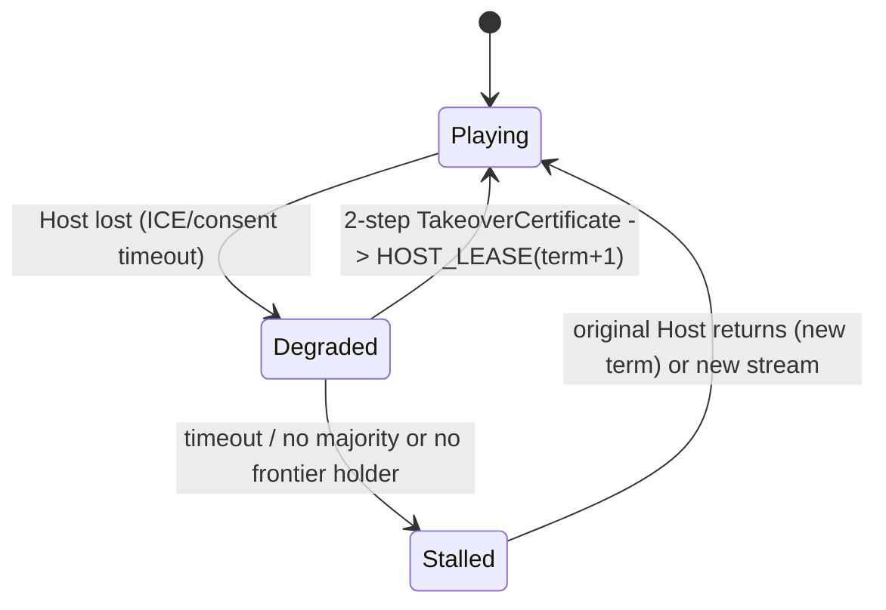

# Synchronization — Lockstep Playback & PI Control

Everyone in the room watches the same frame at the same moment. Normative
`SYNC` / `START_AT` / `CONTROL_REQ` / `TAKEOVER_*` formats live in
[protocol.md](../spec/protocol.md) §5 and §7.5.

---

## 1. Single clock authority per term

At any instant, exactly one peer — the **Host** holding the current
`HostLease(stream_id, term)` — is the authoritative clock:

- The Host broadcasts `SYNC { stream_id, term, seq, t_media_ms, state: PLAY |
  PAUSE, rate }` every **1 s** and **immediately** on any play/pause/seek/rate
  event.
- In **`DEMOCRATIC`** mode, only the Host's transport controls change the room
  clock.
- In **`COLLABORATIVE`** mode, any member may send `CONTROL_REQ { stream_id,
  term, action }` to the Host; the Host validates and applies it, then
  immediately broadcasts the new authoritative `SYNC`. Single-clock simplicity
  is preserved in both modes.
- A `SYNC` from a non-host or stale term is rejected as an authority violation
  (`PW_AUTHORITY_VIOLATION`).

---

## 2. Estimating host time locally (sliding-window min-delay filter)

`SYNC` carries **no** Host wall clock. Followers estimate the Host's media
position purely against their own monotonic clock:

1. `PING`/`PONG` every 5 s maintains `minRTT` (minimum RTT over the last 30 s,
   isolating pure propagation delay). One-way delay ≈ `minRTT / 2`.
2. When `state == PLAY` at host playback rate `R` (typically `1.0`), each
   incoming `SYNC` received at monotonic time `t_local` implies a media-clock
   origin offset:
   ```
   offset_sample = (t_media + R · minRTT / 2) − R · t_local
   ```
3. To suppress transient Wi-Fi/SCTP jitter on individual `SYNC` packets, the
   follower maintains a sliding window of the last 8 `offset_sample`s (while
   continuous `PLAY` at constant `R` holds) and tracks the **median / filtered
   offset** `ô`:
   ```
   r(t) = ô + R · t_local          (when state == PLAY)
   r(t) = t_media                  (when state == PAUSE)
   ```
4. On any discontinuity — `START_AT`, state transition (`PLAY` ↔ `PAUSE`),
   host rate change `ΔR`, or media jump `|offset_sample − ô| > 500 ms` (a host
   seek) — the sliding window resets immediately to the fresh sample.

This needs zero wall-clock synchronization between machines; residual error is
RTT path asymmetry (typically 5–25 ms).

---

## 3. Following the clock: retuned PI controller

```
e(t)    = x_local(t) − r(t)                         // >0 means follower is ahead
ê(t)    = EWMA(e, α = 0.25)                         // smooth measurement jitter
rate(t) = clamp( R · (1 − Kp·ê(t) − Ki·∫ê dt), 0.95·R, 1.05·R )
```

### 3.1 Human-tuned gains (critically damped, imperceptible)

- **Critical damping** (`ζ = 1`, zero overshoot): `Ki = Kp² / 4`, envelope time
  constant `τ = 2 / Kp`.
- **Selected gains**: **`Kp = 0.30`**, **`Ki = 0.0225`** → `τ ≈ 6.67 s`.
- **50% step reduction time**: `2 · 1.678 / 0.30 ≈ 11.2 s` — fast enough that
  small hiccups vanish cleanly within seconds.
- **Imperceptible rate clamp**: **±5%** (`[0.95, 1.05]` relative to `R`). Both
  HTML5 `video.playbackRate` (`preservesPitch = true`) and `mpv` `speed`
  (`audio-pitch-correction=yes`) sound completely natural within ±5%.
- **Steady-state skew cancellation**: an audio crystal running 0.1% fast
  (`ρ = 0.001`) manufactures 3.6 s/hour of drift. The integral term accumulates
  to cancel `ρ` exactly, driving steady-state error to ~0 (bounded only by RTT
  noise, ~10–30 ms).

### 3.2 Operating rules

- **Hard-seek threshold**: if `|e| > 2.0 s` (post-stall, host seek,
  return-to-live), perform a **hard seek** to `r(t)` (snapped to the nearest
  segment keyframe), reset the integrator, and resume PI tracking.
- **Anti-windup**: integrate `ê` only while `|e| < 1.5 s` and the rate output
  is not clamped.
- **Host paused**: followers pause and snap once if `|x_local − t_media| > 0.3 s`;
  PI disengages until `PLAY`.
- **Position feedback rate**: both MSE (`timeupdate` + 50 ms timer) and `mpv`
  (`observe_property("time-pos")`) report position at ≥ 10–20 Hz.

---

## 4. Buffer awareness

- If playable buffer ahead drops below **2 s**, the follower pauses locally,
  marks `PRESENCE = BUFFERING`, emits `STALL_NOTICE`, and elevates the
  scheduler's `URGENT` window.
- Once **≥ 4 s** is buffered, playback resumes (hard-seeking back to `r(t)` if
  `|e| > 2.0 s`).

---

## 5. Free-roam

Any viewer may pause locally or scrub back/forward without affecting anyone
else:

```
FOLLOWING ──local pause/seek──► FREE_ROAM
FREE_ROAM ──"Return to live"──► FOLLOWING (hard seek to r(t), PI reset)
```

In `FREE_ROAM`, incoming `SYNC` messages update `r(t)` silently so the UI shows
exact delta ("1:18 behind live"), while the scheduler centers `URGENT`/`WINDOW`
around the roamer's own playhead. Roamers remain full uploading and voting
swarm members.

---

## 6. Host loss and 2-step takeover



1. **Degraded**: playback continues on segments the swarm already holds.
2. **2-step takeover**:
   - A candidate holding verified segments at/ahead of `t_media_ms` broadcasts
     `TAKEOVER_CLAIM { stream_id, from_term, to_term: from_term + 1,
     candidate_pubkey, t_media_ms, roster_snapshot }` (where `roster_snapshot`
     is the active connected roster excluding the lost Host).
   - Each peer in `roster_snapshot` verifies possession (either from verified
     frontier blocks already received from the candidate, or via an optional
     `CHALLENGE` of ≤ 4 blocks answered by `CHALLENGE_RESPONSE` within 5 s),
     then broadcasts `TAKEOVER_ACK { claim_hash }`.
   - Upon gathering a strict majority of `TAKEOVER_ACK`s, the candidate
     publishes `HOST_LEASE(to_term)` carrying `TakeoverCertificate` and resumes
     the room clock from `t_media_ms`.
3. **Partitions**: only a component holding a strict majority of the active
   roster can mint a valid `TakeoverCertificate`. Minority components stall
   safely and converge on the higher valid `term` upon partition heal.
