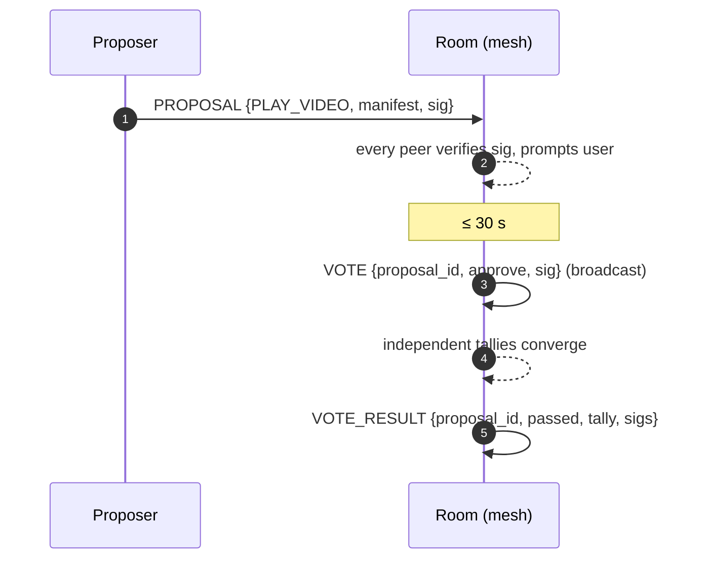

# Governance — Proposals, Votes, Host Changes, Kicks

A PeerWatch room has **no privileged roles**. The room creator gets nothing.
The Host gets exactly two duties (seed authority, clock authority) and no
powers over people. Every collective decision (what to watch, who stays)
is made the same way: **signed proposals, signed votes, deterministic
tallies computed independently by every peer.**

This matches the intended room flow:

> someone starts a room → peers join → a peer proposes a video they have
> locally → the room votes → on passing, the video plays and the proposer
> becomes Host.

---

## 1. Objects

```
Proposal = {
  proposal_id,                    // random 128-bit
  kind: PLAY_VIDEO | KICK,
  payload,                        // per kind, below
  created_at_ms, expires_at_ms,   // default lifetime: 30 s
  proposer_pubkey,
  proposer_signature,             // over all of the above
}

Vote = {
  proposal_id,
  approve: bool,
  voter_pubkey,
  voter_signature,
}
```

- `PLAY_VIDEO` payload: the **manifest** ([distribution.md](distribution.md)),
  pipeline info (remux / transcode-ahead / transmux, so voters know if
  quality is lossy), and the proposer's capability flags.
- `KICK` payload: target pubkey + free-text reason.

## 2. Rules

1. **Eligibility**: every peer currently in the room roster may vote once
   per proposal. One key = one vote, votes are non-transferable and
   non-changeable (simplicity beats revote logic in a 30 s window).
2. **Threshold**: a proposal passes when `approvals > connected_roster / 2`,
   a **strict majority of the peers connected at tally time** (counted
   over the signed roster snapshot, so a mob of fresh socket connections
   without valid AUTKeys doesn't count).
3. **Expiry**: unpassed proposals die at `expires_at_ms`, results are
   broadcast (`VOTE_RESULT`) either way so all UIs converge.
4. **Determinism**: every peer verifies every signature and tallies
   independently. Identical inputs → identical outcome. There is no
   "vote server" to disagree about. Conflicting `VOTE_RESULT` announcements
   are detectable (signed claims contradicting a verifiable tally) and are
   treated as protocol violations ([security.md](security.md)).



---

## 3. PLAY_VIDEO: host transition protocol

On passage:

1. **Role handoff**: the proposer becomes **Host-elect**, any previous Host
   is demoted to ordinary seeder (it keeps its store, so old-content pieces
   may still be served to stragglers, but the room's attention moves on).
2. **Manifest distribution**: the Host-elect sends the manifest to any peer
   missing it. (For live-transcode proposals the manifest is incremental, see
   [media-pipeline.md](media-pipeline.md) §5.)
3. **Buffering gate**: the Host-elect begins serving immediately, peers'
   schedulers fill URGENT/WINDOW. When every connected peer reports
   `READY` (init segment + ≥ 2 segments buffered) **or** 20 s elapse
   (whichever first), the Host broadcasts:

```
START_AT { host_wallclock_ms, t_media: 0 }
```

   Everyone starts decode aligned on that timestamp, the PI controller
   ([sync.md](sync.md)) absorbs the residual milliseconds.
4. **From then on**: the new Host's transport is the room's clock, the old
   video's data plane winds down (peers may keep seeding it to complete
   peers who want the file).

**Proposer obligation**: proposing is a commitment to *stay*. A peer whose
proposal passes and then immediately leaves triggers the standard host-leave
path ([sync.md](sync.md) §6), which, if nobody has pieces yet, means an
instant stall. UIs warn proposers accordingly.

## 4. KICK: removing a peer

On a `KICK` proposal passing:

1. The target's **public key** is added to the room **banlist** (persisted
   per room, gossiped in `ROOM_STATE` so late joiners enforce it too).
2. Every peer: tears down its connection to the target, ignores its further
   messages, and refuses future AUTH handshakes carrying that key.
3. The signaling relay can't be told *why* (it sees ciphertext), but it
   doesn't need to know: envelopes addressed to the banned ID are simply
   never answered. A mesh that refuses you is a partition of one.
4. **Re-entry**: with the same key, impossible (AUTH fails at every peer).
   With a *fresh* key, technically possible (a new peer ID), but requires
   the token and is visibly a new identity, repeat offenders are re-kicked
   at trivial cost. Sybil discussion: [security.md](security.md) §6.

Kicks are the *social* tool. **Cryptographic misbehavior needs no vote**:
hash-poisoning, signature failures, and protocol violations trigger
*immediate local bans* by any witness ([security.md](security.md) §3), with
signed `BAN_REPORT`s gossiped as advisory evidence. Votes are for
judgment calls. Math handles the rest.

## 5. Edge cases and their resolutions

| Case | Resolution |
|------|-----------|
| Concurrent PLAY_VIDEO proposals | Both may be voted on, ties in passage time are broken by `proposal_id` order, the later one wins by room-wide rule (its `START_AT` supersedes). UIs show "another proposal is active". |
| Proposal passes while a vote on a KICK of the proposer is running | Independent outcomes, if both pass, kick executes (the new Host is removed → host-leave path). |
| Proposer leaves mid-vote | Proposal expires harmlessly. |
| Host loses connectivity but room is split (partition) | Each component follows [sync.md](sync.md) §6, on heal, the component containing the reigning Host wins clock authority, tallies merge by signature sets. |
| Exactly-2-person room, 1–1 vote | Strict majority of 2 = 2 → proposals require unanimity. Documented, intended. |
| Griefing via repeated proposals | Rate limit: one active proposal per peer, proposal spam → protocol-violation strikes. |

## 6. What governance deliberately does not do

- **No moderators, no veto, no creator powers.** If a group wants an
  iron-fisted host, they can simply… not pass votes they dislike.
- **No content arbitration.** Peers vote on *whether* to watch, not on
  whether a file is "allowed". (A malicious *file* is a different threat,
  see the media-parser discussion in [security.md](security.md).)
- **No persistent reputation across rooms.** Reputation is per-room
  ([security.md](security.md) peer scoring), cross-room identity reputation
  is a possible extension, deliberately out of v1 scope.
