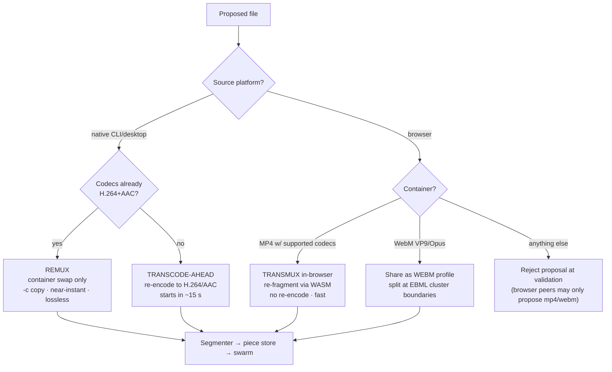

# Media Pipeline — From "Any Local File" to the Canonical Stream

The Go version of PeerWatch shared the *original file bytes* and let mpv
deal with them. That worked because every peer was a desktop with mpv. It
cannot work in a browser: a web page cannot hand a half-downloaded MKV to a
`<video>` element. Browsers stream video through **MSE (Media Source
Extensions)**, and MSE demands a specific shape of data.

This document explains that shape (fragmented MP4), why it was chosen, and
the three pipelines that convert a proposed file into it: **remux**, **live
transcode-ahead**, and **in-browser transmux**.

---

## 1. How a browser actually plays streamed video

A `<video src="movie.mp4">` element downloads progressively and can start
playing early, but only *from the beginning*, and seeking requires the
server to support byte ranges *and* the file to have a seekable index. That
model is useless for P2P, where data arrives out of order from many peers.

The real streaming API in browsers is **MSE**:

1. JavaScript creates a `MediaSource` and attaches it to a `<video>`.
2. It adds a `SourceBuffer` describing one stream's format, e.g.
   `video/mp4; codecs="avc1.640028,mp4a.40.2"` (H.264 video + AAC audio).
3. It then **appends bytes** to that buffer:
   - first an **initialization segment** — container headers + codec
configuration (`ftyp` + `moov` boxes in MP4 terms),
   - then any sequence of **media segments**, each starting on a video
      **keyframe**, each self-contained enough to decode (`moof` + `mdat`).
4. The player decodes appended media continuously, JS manages the buffer
   (appending ahead of the playhead, evicting behind it).

This is how YouTube, Twitch, and every serious web player work. The key
facts for us: **segments are the unit of playback**, segments must start on
keyframes, and the app controls exactly which bytes arrive when, a perfect
match for a P2P chunk scheduler.

---

## 2. The canonical wire format

> **Everything the swarm shares is one of two stream profiles:**
>
> | Profile | Container | Video codec | Audio codec | When used |
> |---------|-----------|-------------|-------------|-----------|
> | `FMP4` (default) | fragmented MP4 | H.264 (AVC) | AAC | Anything a native peer proposes, the universal target |
> | `WEBM` | WebM (EBML clusters) | VP9 | Opus | Browser-proposed `.webm` files (can't cheaply become MP4 in-browser) |

**Why fragmented MP4 / H.264 / AAC as the default:**

- **MSE support is universal**: Chrome, Firefox, Safari, and WebKitGTK (the
  Tauri webview) all decode H.264+AAC in fMP4 via MSE. It is the only
  combination that needs no per-browser negotiation.
- **mpv plays it natively**, so CLI and desktop-mpv-fallback consume the
  *identical bytes* the browser gets. One wire format, no dual distribution.
- **ffmpeg emits it trivially** (see §4).
- **Segments double as the seek index**: because every segment starts on a
  keyframe, seeking to time T = jump to the segment containing T and decode
  forward. No cross-segment dependencies.

A plain ("progressive") MP4 file is **not** directly streamable via MSE: its
single `moov` box describes the whole file and its frames aren't grouped
into independently-decodable fragments. Converting MP4→fMP4 is a container
operation, not a re-encode (§3).

---

## 3. The three source pipelines

When a peer proposes a file, `pw-media` **probes** it (native: `ffprobe`,
browser: a lightweight demux pass) and selects a pipeline:



### 3.1 REMUX (the fast path)

If the file's codecs are already H.264 + AAC but the container isn't
fragmented (typical: `.mkv`, plain `.mp4`), we only change the *container*:

```
ffmpeg -i in.mkv -c copy \
       -movflags +frag_keyframe+empty_moov+default_base_moof \
       -f mp4 out.fmp4
```

`-c copy` passes encoded frames through untouched: **lossless, near-instant,
I/O-bound** (a 10 GB file remuxes in tens of seconds on SSD, and streaming
remux can start emitting segments immediately). CPU cost: a few percent.

### 3.2 TRANSCODE-AHEAD (the compatibility path)

If codecs are incompatible with the universal profile (HEVC, AV1, VP9-in-MKV,
AC3, DTS, …), the file must be re-encoded to H.264/AAC. Doing this for a
whole movie before anyone watches would mean minutes of dead time, so
PeerWatch **transcodes while the room watches**:

1. `ffmpeg -i in.X -c:v libx264 -preset veryfast -c:a aac -movflags +frag_keyframe+empty_moov+default_base_moof -f mp4 -` writes the fMP4 stream to a **pipe**.
2. The **segmenter** parses the stream into segments as they emerge and feeds them to the piece store, the Host's bitfield grows in real time.
3. Playback begins after a **~15 s head start** (a few segments exist, enough for peers to buffer).
4. A **throttle** keeps the encoder ~60–120 s ahead of the room playhead (the segmenter simply stops reading the pipe, ffmpeg blocks on write, resume when the window advances). This bounds CPU bursts and temp disk.
5. Temp disk ≈ the size of the transcoded copy, freed when the room ends.

Preset: **x264 `veryfast`** (decision log, [roadmap.md](roadmap.md)), the
best speed/quality trade for live work: ~2–5× realtime for 1080p on a
modern 4–8-core CPU (30–70 % machine load while active). See
[performance.md](performance.md) §4. A higher-quality opt-in preset for
powerful hosts is a planned config knob.

Note: remux output and transcode output go through the *same* segmenter, so
downstream code doesn't care which path produced the stream.

### 3.3 TRANSMUX (browser-proposed files)

Browsers can't run ffmpeg (ffmpeg.wasm exists but is too slow for real-time).
But a browser peer may only propose **mp4/webm** (rule from the product
spec), and crucially:

- **MP4 with MSE-supported codecs** needs no re-encode, only
  *re-fragmentation*: parse the MP4 sample tables and repackage the samples
  into fMP4 segments. This "transmuxing" is pure container math and runs
  fine in WASM/JS (mp4box-style demux → our segmenter). Fast, lossless.
- **WebM (VP9/Opus)** can't cheaply become MP4 in-browser, but browsers
  play WebM natively via MSE (`video/webm; codecs="vp9,opus"`). So WebM is
  shared as the `WEBM` profile, segmented at **EBML cluster** boundaries
  (clusters already start on keyframes, WebM's natural segment equivalent).
- **Anything else** (an mp4 wrapping HEVC, an AVI, …) fails validation:
  the prober checks `MediaSource.isTypeSupported` for the exact codec
  string, and the proposal is rejected before it reaches a vote, with a
  clear message.

Native peers receiving a `WEBM` stream are unaffected, mpv decodes VP9/Opus
natively.

### 3.4 Segment sizing

Segments target **4 seconds** of media (keyframe permitting, the encoder is
configured with a max GOP of 4 s so keyframes exist at least that often).
Trade-off: shorter segments = finer seek granularity and faster cold start,
but more overhead and larger segment tables, 4 s sits at the industry sweet
spot (DASH/HLS defaults).

---

## 4. ffmpeg command reference

| Task | Command sketch |
|------|----------------|
| Probe | `ffprobe -v quiet -print_format json -show_format -show_streams in.X` |
| Remux | `ffmpeg -i in.X -c copy -movflags +frag_keyframe+empty_moov+default_base_moof -f mp4 pipe:1` |
| Transcode | `ffmpeg -i in.X -c:v libx264 -preset veryfast -crf 23 -c:a aac -b:a 160k -movflags +frag_keyframe+empty_moov+default_base_moof -f mp4 pipe:1` |
| GOP control | add `-g 120 -keyint_min 24` (≈4 s max GOP at 30 fps) |

The desktop app bundles/uses system ffmpeg, the CLI requires `ffmpeg` on
`PATH` and fails with a clear install hint otherwise. Browser peers never
need ffmpeg.

---

## 5. What the segmenter actually does

The segmenter is the bridge between "ffmpeg output" and "the swarm's data
model" ([distribution.md](distribution.md)):

1. **Parse boxes**: read the fMP4 stream box-by-box. Emit box 0–N (`ftyp`,
   `moov`) as the **init segment**. Each `moof`+`mdat` pair is one **media
   segment**, timestamps are read from the `moof`'s `tfdt`.
2. **Index**: append `{t_start, t_end, piece_start, piece_end}` to the
   segment table.
3. **Chunk**: slice segment bytes into 512 KiB pieces (the init segment is
   piece 0 territory), hash each piece (SHA-256), store, and extend the
   Host's bitfield.
4. **Throttle**: pause reading when `last_segment_time − playhead > 120 s`
   (transcode path only).

Because the manifest's piece hashes must exist *before* peers can verify,
a live-transcoded video's manifest is **incremental**: the initial manifest
describes the stream parameters and segment table grows via signed
`MANIFEST_APPEND` messages ([protocol.md](protocol.md)). A remuxed or
transmuxed file is processed fast enough that its manifest is effectively
complete at proposal time.

---

## 6. Quality & policy notes

- **Remux is lossless, transcode is not.** x264 CRF 23 veryfast is
  visually transparent for most 1080p content, but it *is* a generation of
  loss. The proposal message always states which pipeline will be used, so
  voters know. (An "original-quality download" side-channel is a possible
  extension, not v1.)
- **Native-only rooms MAY skip normalization.** If every peer is native
  (capability flags in the handshake), a room may share the original
  container directly, mpv handles anything. The manifest supports arbitrary
  profiles, this is a config option, off by default, because it silently
  breaks for any browser peer that joins later.
- **Subtitles**: out of scope for v1 (the pipeline passes only the first
  video + first audio stream). The manifest has a reserved field for
  subtitle tracks.
