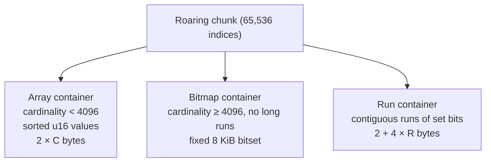

# Roaring Bitfield Compression

Peers advertise piece availability by broadcasting a `BITFIELD` over the
control channel every 1 second ([distribution.md](../design/distribution.md) §3). This
document specifies the on-wire encoding of that bitfield — the **Portable
Roaring Bitmap** format. It is a normative companion to
[protocol.md](protocol.md) §7.4 (message `0x20`).

A bitfield is a **scheduling hint**, not proof of possession. It never
authorizes a takeover, ban, or vote. A liar only wastes requests; block
Merkle proofs adjudicate data.

---

## 1. Why compress the bitfield

In the raw encoding, piece index `i` maps to bit `i`, so a video with `N`
pieces costs `N/8` bytes per broadcast per peer:

| Video | Pieces | Raw bitfield |
|-------|-------:|-------------:|
| 6 GB (1080p, ~2 h) | 12,288 | 1,536 B |
| 18 GB (4K, ~2 h) | 36,864 | 4,608 B |
| 100 GB (large library) | 200,000 | 25,000 B |

PeerWatch's access patterns are highly structured, so the raw encoding wastes
bandwidth:

1. **Host and complete peers** hold `0..N-1` as one contiguous run.
2. **Fresh joiners** hold nothing (all clear).
3. **Active viewers** hold a contiguous window around the playhead plus a
   sparse set of rare-reserve / backfilled pieces
   ([storage.md](../design/storage.md) §2.3).

Roaring Bitmaps exploit that structure by partitioning the index space and
picking, per partition, the smallest of three container representations. The
result is an **80–99.8 %** reduction in bitfield size depending on peer
state.

---

## 2. Roaring structure

A Roaring Bitmap splits the 32-bit piece-index space into chunks of
`2^16 = 65,536` consecutive values. A chunk is addressed by the **upper 16
bits** of its indices; the **lower 16 bits** live inside one **container**.
Each container independently selects the cheapest of three representations:

### 2.1 Array container
Used when a chunk holds **fewer than 4,096** set bits.

- **Layout**: a sorted array of `u16` values, one per set bit.
- **Size**: `2 × C` bytes (`C` = cardinality).
- **Best for**: sparse ownership — a peer that has only a few isolated pieces.

### 2.2 Bitmap container
Used when a chunk holds **4,096 or more** set bits with no long contiguous runs.

- **Layout**: a fixed `2^16`-bit (8,192-byte / 8 KiB) bitset.
- **Size**: exactly 8,192 bytes regardless of exact cardinality.
- **Best for**: dense, fragmented (high-entropy) distributions.

### 2.3 Run-length encoded (RLE) container
Used when set bits form **contiguous runs of consecutive values**, regardless
of cardinality.

- **Layout**: a `u16` run count followed by `R` run pairs, each a
  `(u16 start, u16 length)`.
- **Size**: `2 + 4 × R` bytes (`R` = number of runs).
- **Best for**: contiguous ownership — a complete host (1 run) or a contiguous
  watched prefix (1 run).

A single video with `N ≤ 65,535` pieces fits in **one** chunk, so its
bitfield is whichever single-container representation is smallest.

---

## 3. Encoding requirement (normative)

- The `bits` field of a `BITFIELD` message carries a bitmap serialized in the
  **Portable Roaring Bitmap format** (the standard layout defined at
  roaringbitmap.org).
- **Senders MUST emit the run-optimized representation**: any container whose
  set bits form one or more long runs MUST be encoded as a run container, not a
  bitmap container. A naive insert-only bitmap leaves dense chunks as 8 KiB
  bitsets (see the “un-optimized” column in §4) — larger than the raw `N/8`
  bitfield — which defeats the entire point of compressing.
- Receivers deserialize per the portable format and use the result to update
  the sender's availability and the room availability table.

> **Integrity is unaffected.** Roaring encodes only the *availability*
> bitfield. `BLOCK` payloads remain raw 32 KiB bytes, each with a Merkle
> proof against its piece root ([protocol.md](protocol.md) §6).
> Compression never touches media bytes.

---

## 4. Sizing (measured against `roaring 0.11`, portable format)

| Peer state | Raw `N/8` | Un-optimized | Run-optimized | reduction |
|------------|----------:|-------------:|---------------:|----------:|
| Fresh joiner (0 pieces) | 1,536 B | 8 B | 8 B | — |
| Complete host/seeder, 6 GB | 1,536 B | 8,208 B | **15 B** | 99.0% |
| Complete host/seeder, 4K | 4,608 B | 8,208 B | **15 B** | 99.7% |
| Complete, 100 GB (200k pieces) | 25,000 B | 31,400 B | **61 B** | 99.8% |
| Early contiguous downloader (10%) | 1,536 B | 2,474 B | **15 B** | 99.0% |
| Browser sliding-window, 6 GB | 1,536 B | 1,922 B | **467 B** | 69.6% |
| Browser sliding-window, 4K | 4,608 B | 1,928 B | **479 B** | 89.6% |
| Native 50%-prefix + backfill, 6 GB | 1,536 B | 8,208 B | **399 B** | 74.0% |
| Native 50%-prefix + backfill, 4K | 4,608 B | 8,208 B | **1,235 B** | 73.2% |

(6 GB = 12,288 pieces; 4K = 36,864. Sliding-window = 840-piece contiguous
window + ~120 scattered rare-reserve pieces, per [storage.md](../design/storage.md)
§2.3.)

Two facts fall out of the table:

1. **Run-optimization is mandatory, not optional.** Without it, every dense
   chunk serializes as an 8,192-byte bitset — the “un-optimized” column is
   often *larger* than the raw `N/8` bitfield. The §3 requirement exists for
   this reason.
2. **Scattered peers do not compress to “a few bytes”.** A browser
   sliding-window peer holds a contiguous window *plus* scattered rare-reserve
   pieces; each scattered piece is its own singleton run, so the size scales
   with the number of runs (~470 B), not with cardinality. The dramatic wins
   (~15 B) belong to *contiguous* states — complete hosts and contiguous
   prefixes.

**Roaring is not universally smaller than raw.** A bitmap container is
8,192 bytes, which is larger than a 1,536-byte raw bitfield for a
12k-piece stream. The accurate claim is: **run-optimized Roaring is smaller
for structured availability; unoptimized Roaring can be larger.** That is
exactly why §3 makes run-optimization a sender requirement rather than a
tuning knob.

### 4.1 Room-wide (16-peer representative mix: 1 fresh, 4 complete, 8 sliding-window, 3 mid-download)

| Video | Raw room-wide | Roaring room-wide |
|-------|--------------:|------------------:|
| 6 GB | ~24 KB/s | ~5 KB/s |
| 4K (18 GB) | ~72 KB/s | ~8 KB/s |

Originated bandwidth (each peer emits one bitfield/s). Full-mesh wire cost is
~15× these figures in both columns, so the ratio is unchanged (~80–90 % less).

---

## 5. Why Roaring (and not a generic compressor)

Roaring is structure-aware, so a **run-optimized** bitmap is usually smaller
than the raw bitfield for the structured cases PeerWatch produces. Its
per-chunk min-selection can choose array, bitmap, or run containers; the
sender requirement ensures it actually chooses run containers for long runs.
Generic compressors (gzip/zstd) do not know about the piece-index structure,
cost CPU per tick, and give poor results on scattered regions.

Roaring also gives O(containers) bitwise operations: the scheduler's
availability-table maintenance (`OR` across peers), missing-piece detection
(`peer AND NOT local`), and seek-window intersection can run directly on the
compressed container representation, without materializing a full `N/8`
bitset.

---

## 6. Validation rules (normative)

Receivers MUST reject a `BITFIELD` whose bytes fail the portable-format
deserialization, and apply these bounds (failures follow the strike/ban ladder
in [security.md](../design/security.md) §4):

1. **Cardinality gate**: `bitmap.len()` MUST be ≤ the stream's piece count.

   For a **final or static** stream this is `manifest.total_pieces`. For a
   **live** stream (`MANIFEST_APPEND` in flight, or an append the receiver
   has not yet applied) the bound is the receiver's best known
   `total_pieces`, and a bitfield naming indices beyond it MUST be
   **buffered, not rejected**: it means the sender is ahead of this
   receiver's manifest version. The receiver requests the missing
   `MANIFEST_APPEND`/head (§6.5 of the schema) and re-evaluates the bitfield
   afterwards.

   Rejecting on this condition would strike every peer during a live
   transcode, because the Host's frontier necessarily advances before a
   follower applies the append. The rule is therefore: **an out-of-range
   bitfield is a manifest-version signal first and a protocol violation
   only if it survives a manifest resync.**

   An empty bitmap (`len() == 0`, no maximum) is valid — it is a fresh
   joiner's first broadcast.
2. **Payload cap**: a `BITFIELD` whose deserialized byte size exceeds **16 KiB**
   is rejected. Run-optimized bitfields for ≤ 16-peer, sub-100 GB streams are
   at most ~1.3 KB; 16 KiB is a generous ceiling that still blocks resource
   exhaustion.
3. **Rate**: at most one `BITFIELD` per second per peer; excess is a strike.
4. **No authority**: a bitfield never affects host election, ban decisions,
   or vote counts. It only shapes requests.
