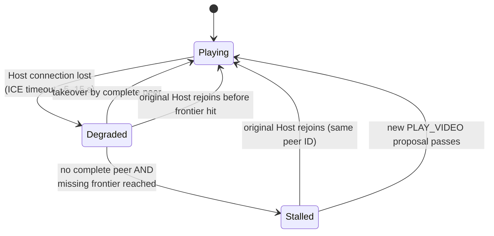

# Synchronization — Watching in Lockstep

A watch party is only a party if everyone sees the same frame at the same
moment. This document specifies the sync model: who owns the clock, how
followers track it (a PI feedback controller, with the math), the per-peer
**free-roam** escape hatch, and what happens when the Host vanishes mid-film.

---

## 1. The model: the Host is the clock

At any moment exactly one peer, the **Host** (the owner of the file being
played, [governance.md](governance.md)), is the **clock authority**:

- Only the Host's play / pause / seek / rate actions propagate to the room.
- The Host broadcasts its transport state on the control channel:

```
SYNC { t_media, state: PLAY | PAUSE, rate, host_wallclock_ms }
```

  …every **1 s** (heartbeat) **and immediately** on any transport event.
- Viewers' local transport controls do **not** affect anyone else. (A
  viewer's local pause/seek drops them into free-roam instead, see §5.)

Why a single authority and not, say, averaging? Because watch-party sync is
a *social* feature ("we're all at the same scene"), not a fairness problem:
one unambiguous reference is simple, converges instantly, and matches the
product rule that the file's owner runs the show.

---

## 2. Estimating "host time" locally: RTT compensation

A SYNC saying "I'm at 45.2 s" arrives some milliseconds after it was true.
Followers correct for that transit time:

- Each connection maintains RTT via `PING/PONG` on the control channel.
- The estimator uses the **windowed minimum RTT** (min over the last ~30 s),
  not the mean: the minimum is the cleanest estimate of pure propagation
  delay. Queueing only ever *adds* delay, so the least-delayed samples are
  the most truthful. (Same trick NTP-flavored designs use.)
- One-way delay ≈ `minRTT / 2`. The follower's estimate of the Host's
  *current* position is:

```
r(t) = t_media + (state == PLAY ? rate · (now − host_wallclock + minRTT/2) : 0)
```

Residual error is the RTT asymmetry, typically 5–25 ms on broadband, far
below perceptibility (§3.4).

---

## 3. Following the clock: a PI controller

v1 used an ad-hoc three-tier scheme (|drift|>2 s → seek, ±0.5–2 s → fixed
0.95×/1.05×, else 1.0×). It had real defects:

- a **permanent standing error** of up to ±0.5 s inside the deadband,
- **discontinuities** — audible speed *steps* at threshold crossings,
- **boundary oscillation** when drift hovers at a threshold,
- no way to cancel **systematic clock skew** (audio clocks commonly run
  ±0.05–0.1 % off → 2–7 s/hour of manufactured drift, re-fought forever).

The replacement is textbook feedback control: a **PI (proportional–integral)
controller** driving the playback rate.

### 3.1 The control law

```
e(t)    = x_local(t) − r(t)                     (position error; >0 = ahead)
ê(t)    = EWMA(e, α = 0.2)                      (filter RTT jitter — don't chase noise)
rate(t) = clamp( 1 − Kp·ê(t) − Ki·∫ê dt , 0.9 , 1.1 )
```

The plant is trivial: position integrates rate (`dx/dt = rate − 1` relative
to the reference). The closed-loop error dynamics are:

```
s² + Kp·s + Ki = 0          (characteristic equation)
```

### 3.2 Gain selection (with reasons)

- **Critical damping** (ζ = 1, no overshoot. Overshoot in playback is
  nauseating): `Ki = Kp² / 4`.
- **Time constant τ = 1/Kp ≈ 25 s**, corrections are spread over ~half a
  minute, so rate deviations stay ≲ 4 % and *fade* instead of stepping.
  (Perceptibility of rate change for most content: ~2–5 %.)

```
Kp = 0.04        Ki = 0.0004
```

Worked example: you're 0.8 s behind → rate = 1 + 0.8/25 ≈ **1.032** → error
decays exponentially, halving every τ·ln2 ≈ 17 s, never audible.

### 3.3 Why the integral term is the whole game

With a constant local clock-rate offset ρ (your audio hardware runs 0.1 %
fast), a P-only loop settles at `e* = −ρ/Kp` — a **permanent** 2.5 s error
for ρ = 0.1 %. The integrator accumulates until it *exactly* cancels ρ, so
steady-state error → 0, bounded only by RTT-estimation noise (~10–50 ms).
Two peers 50 ms apart are perceptually simultaneous. v1's deadband left 10×
that.

### 3.4 Operating rules

- **Mode switch (gain scheduling):** the linear loop is only valid for small
  errors. If `|e| > 5 s` (post-stall, post-seek, return-to-live) → **hard
  seek**, reset the integrator, then track. Between 0 and 5 s the PI loop
  handles everything, no intermediate speed steps exist at all.
- **Anti-windup:** the integrator accumulates only while `|e| < 2 s` and the
  rate isn't clamped, so a long stall can't charge the integrator into a
  post-recovery lurch.
- **While the Host is paused:** followers pause and seek once to
  `t_media`, the loop disengages until PLAY resumes.
- **Implementability:** browsers expose `playbackRate`, mpv exposes
  `speed`. Same law, both players. The D term of PID is deliberately absent:
  position measurements carry RTT noise, and differentiation amplifies it.

---

## 4. Buffer awareness

The controller tracks the *media* clock, but the *data* must keep up. The
player layer reports buffer health to the sync layer:

- If the appended/downloaded buffer ahead of the playhead drops below ~2 s,
  the follower **locally stalls** (pauses) and reports `BUFFERING` presence.
  It resumes (into the PI loop, which hard-seeks it back to `r(t)`) once
  ≥4 s is buffered. Stall events also feed the scheduler's URGENT class
  ([distribution.md](distribution.md)).
- The Host's broadcasts let the room distinguish "host paused" from "I'm
  starving", so the UI shows different things ("Host paused" vs "buffering…
  you're behind the swarm").

---

## 5. Free-roam: the per-peer escape hatch

Product rule: a viewer may pause to grab food, rewind to rewatch a scene, or
skip ahead, **without affecting anyone else**. Mechanically:

```
FOLLOWING  ──local pause/seek──►  FREE_ROAM
FREE_ROAM  ──"Return to live"──►  FOLLOWING (hard seek to r(t), PI re-armed)
```

- In `FREE_ROAM`, incoming SYNCs no longer move the local playhead. The UI
  shows the delta ("you're 1:42 behind live") and a **Return to live**
  action.
- The **scheduler keeps working around the roamer's own playhead**
  ([distribution.md](distribution.md) §4.1). Free-roam is a *sync* state,
  not a membership state. Roamers keep downloading, verifying, uploading,
  and voting.
- Seeking into not-yet-downloaded territory stalls briefly while the URGENT
  class fills the new window, normal and expected.

---

## 6. When the Host leaves

The Host is two services at once: **seed authority** (the only guaranteed
holder of all pieces) and **clock authority**. Losing it is handled in
stages:



1. **Degraded (seamless if possible).** Playback *continues* on pieces the
   swarm collectively holds, peers keep serving each other. Two sub-cases:
   - **A complete peer exists** (someone finished downloading): the complete
     peer with the lexicographically smallest peer ID deterministically
     broadcasts `SOURCE_TAKEOVER { content_id, t_media }` (signed) and
     becomes the new Host, clock authority included. Viewers' controllers
     switch reference, playback never even stalls. Deterministic choice =
     no election storm, no split-brain: everyone computes the same winner
     from the same roster.
   - **No complete peer**: playback proceeds until playheads reach the
     **missing frontier** (the first piece nobody has), then players stall
     naturally.
2. **Stalled.** UI: *"The source left. Waiting for their return, or propose
   a different video."* The room may wait (the original Host's identity is
   known) or pass a new `PLAY_VIDEO` vote ([governance.md](governance.md)).
3. **Rejoin.** The original Host reconnects with the same keypair → same
   peer ID. If no takeover happened and its content is still current, it
   **resumes** as Host (its persisted store means zero re-setup,
   [storage.md](storage.md)). If a takeover happened, it rejoins as a normal
   complete seeder, there is never more than one clock authority.

The same procedure applies to **transient network partitions**: any
connected component containing the Host (or a complete peer after takeover)
keeps playing, and isolated peers stall and resync on heal via the normal
controllers.

---

## 7. Message timing summary

| Message | Rate | Purpose |
|---------|------|---------|
| `PING/PONG` | every 5 s per connection | RTT/windowed-min estimator |
| `SYNC` | every 1 s + on events | Host clock heartbeat |
| `BITFIELD` | every 1 s | swarm availability (also feeds URGENT decisions) |
| `SOURCE_TAKEOVER` | on event | clock-authority handoff |
| `STALL_NOTICE` | on event | informs room of local starvation (UI + scheduler hints) |

All control messages are signed ([identity.md](identity.md)). A forged SYNC
or TAKEOVER is a signature failure → instant ban
([security.md](security.md)).
